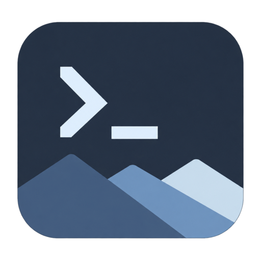

#  Dotfiles

Personal dotfiles managed via `make` + symlinks, cross-platform (macOS and Linux).

## Installation

```sh
$ git clone https://github.com/lanej/dotfiles.git ~/.files && cd ~/.files
$ mkdir -p ~/.config/dotfiles
$ cp config/example.toml ~/.config/dotfiles/config.toml
$ # Edit the additional tool and work-context sets before applying them.
$ make plan     # preview selected tools and configuration
$ make          # configure the native macos or linux baseline
$ make configure # add the tool sets selected in config.toml
$ bash bootstrap.sh # install selected packages and tools
```

Select this machine's additional [configuration sets](#configuration-sets) before running `make configure` or bootstrap. The native OS baseline works without a machine file. Set `tools.mermaid = true` to also install Mermaid CLI (`mmdc`) and its headless browser for inline Mermaid diagrams in Neovim.

`make` defaults to `base`, which detects the OS and applies its baseline configuration. `make configure` adds the bundles selected in TOML; `make setup` and `make all` are aliases for that full configuration. Both paths print a checklist: green `✓` for completed
configuration and integrations, red `✗` with diagnostics for incomplete steps. Missing tools such as `tmux`,
`uv`, or `jq` do not stop other setup steps, and configuration links are installed
independently of optional integrations. It exits nonzero after the full checklist
if anything needs attention. Install the missing dependencies or fix the reported
issue, then rerun the same target; existing links and user configuration are safe to reuse.
Existing fzf-tab checkouts are reused without pulling updates. Linting and tests
run separately with `make lint` and the `test` targets. Color is enabled in
terminals; `NO_COLOR=1` disables it and `CLICOLOR_FORCE=1` enables it for captured output.

The native platform set is selected automatically. Explicit platform tools are rejected on an unsupported OS:

| Set | Baseline configuration |
|---|---|
| `linux` | X11, Polybar, bspwm/sxhkd/rofi configuration |
| `macos` | Yabai/skhd installation and window-manager configuration |

Explicitly requesting an unsupported target fails before writing configuration.
Existing tmux plugin directories are preserved, including local plugins without
Git metadata; failed TPM installation reports an error for manual recovery.

Zsh also starts silently during a partial install. Missing shared files and
optional tools leave the basic prompt, completion, and history available.
The custom fzf integration requires both `fzf` and `fd`; it activates in a new
shell once they are installed. Failed integration generators do not replace
working cached hooks. Run `make test-zsh-startup` to exercise this workflow.

`make benchmark-zsh-startup` measures the current home's interactive login-shell
startup and exit over 30 runs after three warmups. It reports median and p95
wall time for `zsh -d -i -l -c exit`, including process launch and logout,
with global rc files skipped. It inherits your `HOME` and `PATH`; run it on your
workstation for representative timings. Use
`ZSH_BENCHMARK_ARGS='--runs 60 --json'` for more samples and JSON output.

`make configure` with the AI bundle (or `make claude`) also removes installed Claude Code plugins listed in
[`claude/blocked-plugins.json`](claude/blocked-plugins.json) from user scope when
the Claude CLI is available. Add a marketplace-qualified plugin ID to that list
to retire another plugin; Superpowers is the initial entry. Already-absent
installations are a no-op; invalid configuration, inspection, or uninstall
failures mark that step incomplete so they can be fixed.

`make claude-shared` links the shared `ai/skills` and `ai/agents` sources into
Claude's installed directories, preserving local entries. `make claude` includes
this target.

`make codex` also exposes the shared `ai/skills` tree through
`~/.agents/skills/dotfiles`, preserving local Codex skills. Skill directories
remain linked to their sources. File-linked or lowercase entrypoints are
normalized in `~/.codex/dotfiles-skills`; rerun `make codex-skills` after changing
those entrypoints. Missing external skill sources are reported and skipped.

## Configuration sets

`make` and `bootstrap.sh` read the same TOML configuration at `~/.config/dotfiles/config.toml` (or `$XDG_CONFIG_HOME/dotfiles/config.toml`). OS detection selects the `macos` or `linux` baseline; additional tools and work context are explicit, and the hostname has no effect. Python 3.11+ is required for `make`; bootstrap installs Python before resolving settings.

```sh
mkdir -p ~/.config/dotfiles
cp config/example.toml ~/.config/dotfiles/config.toml
# Edit the selected sets, then inspect their resolved settings and source files.
make config
```

For example:

```toml
sets = ["workstation", "easypost"]

# Individual properties override the composed bundles.
[tools]
mermaid = true
neovim = false

[zellij]
source = "release"
```

| Set | Groups |
|---|---|
| `shell` | Zsh, Git, history, search, navigation, and command-line tools |
| `terminal` | Tmux, Zellij, terminal configuration, font, and monitoring |
| `editor` | Neovim, formatters, language servers, and parser tooling |
| `development` | Language runtimes, Rust maintenance, and development cache configuration |
| `ai` | Claude, Codex, Treehouse, Firstmate, and agent status |
| `workstation` | Composes the five tool bundles above, plus mail and Quarto configuration |
| `macos` | Yabai/skhd installation and their configuration |
| `linux` | X11, Polybar, and bspwm configuration for separately installed desktop tools |
| `easypost` | GitHub app access off, EasyPost direnv integration, and Bedrock setup |
| `personal` | GitHub app access on, EasyPost direnv and Bedrock setup off |

The native platform baseline applies first, then the selected bundles extend it. A headless host can select `shell`, `development`, and `ai` and disable desktop recipes individually. On Linux, set `tools.x11`, `tools.polybar`, and `tools.bspwm` to `false`, or maintain a private `linux` set. Work context and additional tool bundles are never inferred from the hostname.

The repository maintains sets in [`config/sets`](config/sets). Add private sets under `~/.config/dotfiles/sets/`; local files take precedence over repository sets of the same name, except `base`. A set can include other sets with its own `sets = [...]` list. Dependencies apply before the including set, each named set applies once, and later sets override earlier properties. Machine properties apply last, including overrides to native platform tools. The always-applied `base` supplies shared property defaults, followed by the native OS set. An unconfigured machine applies only that baseline.

Each `[tools]` property enables or disables one catalog recipe. Shared tool dependencies are added once and installed first. Explicitly disabling a required dependency, selecting an unsupported platform tool, or naming an unknown property fails before the tool plan runs. `false` skips that recipe; it does not uninstall an existing application or change that application's own package/plugin management. GUI, mail, and Ruby entries retain the existing configuration-only behavior; those applications are installed separately.

[`bootstrap/tools.toml`](bootstrap/tools.toml) owns direct package pins, dependencies, installers, Make configuration targets, and preparation/post-install hooks. Bootstrap first ensures uv and Python are available to read TOML, then executes the selected plan through the existing installers and invokes `make configure`. Default `make` chooses only baseline targets; `make configure` applies the baseline plus selected additions. Both respect individual property overrides. Use `make config` to inspect values and their sources, or `make plan` to inspect the baseline, full tool selection, and execution phases without applying them.

Use `make DOTFILES_CONFIG=/path/to/machine.toml` or `DOTFILES_CONFIG=/path/to/machine.toml bash bootstrap.sh` for an alternate configuration. An explicitly selected file must exist. Every catalog tool has a boolean `tools.<name>` property; `codex.github_enabled` controls Codex GitHub access and `zellij.source` selects `"patched"`, `"release"`, or `"main"`.

Neovim installs Taplo through Mason and automatically uses the checkout's local [JSON Schema](config/schema.json) for these settings, private sets, and repository examples. This provides property and value completion, hover documentation, and inline diagnostics for wrong types, unsupported values, and unknown properties. The schema is read locally; its use does not depend on a hosted schema. Set names can reference private files, so missing sets and dependency cycles remain runtime checks. If you select an alternate machine file outside the conventional directory, launch Neovim with the same `DOTFILES_CONFIG` environment variable.

Other Taplo-based editors can associate the same local schema or use a header comment such as `#:schema file:///absolute/path/to/dotfiles/config/schema.json`. The repository's `.taplo.toml` associates its example and set files automatically. The schema is generated from the runtime field definitions and baseline defaults; `make test-dotfiles-config` checks that it has not drifted. After changing those definitions, regenerate it with:

```sh
python3 scripts/dotfiles-config.py --format schema > config/schema.json
```

`make test-dotfiles-config-editor` checks the real Neovim/Taplo editing workflow and requires both tools on `PATH`.

`IS_EASYPOST` and `BOOTSTRAP_MERMAID` are retired. Select `easypost` or `personal` and set `tools.mermaid` directly. Existing installations should select `workstation` and run `make configure` to retain the previous broad setup; the native platform set is automatic. Without a machine file, default `make` configures only the native baseline. Personal machines must explicitly select `personal` to enable GitHub app access. Rerun `make codex-permissions` and reload Codex to apply that access choice. Rerun `make zellij-runtime` to apply a runtime source change, then restart existing Zellij session servers. Set selection does not uninstall previously installed optional tools.

`make codex` converts the shared `ai/agents` Markdown files (including
external symlinks) into personal agents in `~/.codex/agents/*.toml`.
Names, descriptions, and instructions are preserved; Claude model aliases and
tool lists are omitted so agents inherit Codex's model and tools. Agents limited
to Read/Glob/Grep receive a read-only sandbox. Local Codex agents are preserved,
including name collisions. Rerun `make codex-agents` after changing agent
sources, then start a new Codex session. Missing external sources are reported
and skipped.

`make codex` shares Claude's user MCP servers and the MCP servers bundled with
enabled user-scope Claude plugins. Shared definitions come from
`.claude/mcp-servers.json`, merged into Claude's user configuration. Explicit
user definitions take precedence over plugin servers. Codex-only servers remain
installed, and unchanged definitions retain their Codex settings. The Claude
`codex` MCP server is excluded to avoid recursion. Bearer tokens stay in
environment variables, and plugin install paths are resolved without modifying
the plugin cache. Rerun `make codex` after changing server definitions or plugins,
then restart Codex to load the configuration. See Codex's
[MCP configuration documentation](https://learn.chatgpt.com/docs/extend/mcp?surface=cli).

`make codex` also installs the shared Claude/Codex tmux window-status hooks.
Run `make codex-tmux` for just this integration, then restart Codex and trust
the new handlers with `/hooks`. The shell's `codex` function uses `--no-daemon`
inside tmux so hooks inherit the launching pane. See
[tmux window status](docs/tmux.md#claude-and-codex-window-status) for the states
and event mapping.

## Shared shell history

With the Atuin recipe selected, bootstrap configures sharing when an explicit sync host or saved account is available.
Have current dotfiles installed in `~/.files` on the SSH host and authenticate
to any bastion first. Choose another host with
`ATUIN_SYNC_HOST=dev2 bash bootstrap.sh`.

To configure sharing again without reinstalling other tools:

```sh
make atuin-sync                         # configure sharing with dev
make atuin-sync ATUIN_SYNC_HOST=dev2     # use another SSH alias
```

The target installs matching Atuin clients and a Linux server, starts a private
SSH tunnel, and merges existing history. Reruns reuse the account and encryption
key. Original stores stay intact; recovery details are saved with owner-only
permissions at `~/.local/share/atuin/self-hosted-account.json` on both machines.
A replacement Mac can recover those details over SSH from the configured server.
Unlock your SSH agent and authenticate to any bastion before running the target.

## Stack

| Tool | Description |
|---|---|
| [zsh](https://www.zsh.org/) | Shell with autosuggestions and syntax highlighting |
| [starship](https://starship.rs/) | Cross-shell prompt |
| [neovim](https://neovim.io/) | Editor (Lua config) |
| [tmux](https://github.com/tmux/tmux) | Terminal multiplexer |
| [zellij](https://zellij.dev/) | Optional terminal multiplexer trial with tmux-style bindings |
| [kitty](https://sw.kovidgoyal.net/kitty/) | GPU-accelerated terminal |
| [fzf](https://github.com/junegunn/fzf) | Fuzzy finder |
| [skim](https://github.com/skim-rs/skim) | Rust-native fuzzy finder |

See [docs/stack-darwin.md](docs/stack-darwin.md) and [docs/stack-linux.md](docs/stack-linux.md) for platform-specific tools. See [docs/tmux.md](docs/tmux.md) for session persistence and the `tmux-sessions` command.

Bootstrap installs the Zellij runtime selected by your configuration sets; the default is pinned upstream main with native fixes. Run `make zellij` to refresh its configuration and helpers, then `zellij attach --create main` to start a trial session. The `zj main` alias is available in a new shell. See [the Zellij guide](docs/zellij.md) for bindings and remaining tmux integration gaps.

In Kitty, `Alt+1` through `Alt+9` send `F1` through `F9`, `Alt+0` sends `F10`,
and `Alt+-` / `Alt+=` send `F11` / `F12`. On macOS, use Option for Alt.
These shortcuts also work through tmux, so Codex actions such as `F2` and `F4`
are available as `Alt+2` and `Alt+4`. Reload Kitty with `Cmd+Shift+R`.

## Key Makefile Targets

| Target | Description |
|---|---|
| `make` / `make setup` | Install configuration and integrations with a checklist |
| `make lint` | Run skill audits and instruction-size checks |
| `make claude` | Set up Claude skills, commands, agents, and MCP servers |
| `make codex` | Share dotfiles skills and Claude user and plugin MCP servers with Codex |
| `make codex-skills` | Refresh shared dotfiles skills for Codex |
| `make claude-shared` | Link shared skills and agents for Claude |
| `make codex-agents` | Convert shared agents for Codex |
| `make codex-tmux` | Install shared tmux window-status hooks for Codex |
| `make git` | Symlink git configuration |
| `make tmux` | Symlink tmux configuration |
| `make zellij` / `make zellij-config` | Symlink the optional Zellij configuration, layouts, and helpers |
| `make zsh` | Symlink zsh configuration |
| `make cargo` | Symlink Cargo/Rust configuration |

## Directory Layout

```
~/.files/
├── nvim/          # Neovim config (Lua)
├── zsh/           # Zsh config and plugins
├── git/           # Git config and global gitignore
├── kitty/         # Kitty terminal config
├── tmux/          # Tmux config
├── zellij/        # Optional Zellij config and layouts
├── yabai/         # macOS tiling WM config
├── ai/            # Shared skills and agents (selectively versioned)
├── claude/        # Claude configuration and commands
├── bin/           # Utility scripts (selectively versioned)
├── bootstrap/     # Bootstrap helpers
├── docs/          # Tool-specific notes and decision rationale
└── Makefile       # Symlink and setup targets
```

## Machine Migration

```sh
$ sh transfer.sh
```

---

See [docs/](docs/) for tool-specific notes and decision rationale.
For creating and updating pull requests, follow [the PR guidance](docs/pull-requests.md).
