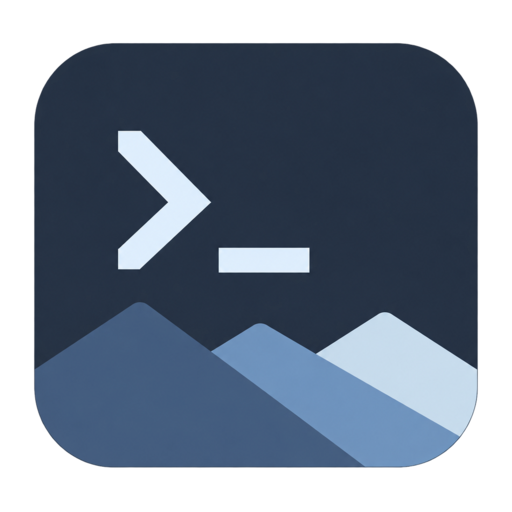

#  Dotfiles

Personal dotfiles managed via `make` + symlinks, cross-platform (macOS and Linux).

## Documentation website

The Astro Starlight site in [`website/`](website/) renders the shared [documentation](docs/index.mdx) from `README.md` and `docs/`; those files are the only documentation sources to maintain. See the [site maintenance guide](docs/documentation-site.mdx) for local development and verification.

## Installation

**Run `make` to apply configuration. Run `make install` to install selected tools and configure them.** Both use this machine's [configuration sets](#configuration-sets).

### Set up a new machine

Requires Git, Make, and Bash on macOS or Linux. The [one-line quick start](docs/index.mdx#quick-start) clones or reuses `~/.files` and runs the minimal bootstrap. To run each step yourself:

**1. Clone and initialize the native configuration.**

```sh
git clone https://github.com/lanej/dotfiles.git ~/.files
cd ~/.files
make base
```

**2. Choose this machine's tools.** Edit `~/.config/dotfiles/config.toml`; use `workstation` for the broad setup, then add work-context sets or individual overrides as needed:

```toml
sets = ["workstation"]
```

The file respects `XDG_CONFIG_HOME` and `DOTFILES_CONFIG`. `make base` creates it only when missing and selects the native `macos` or `linux` baseline. See [configuration composition](#configuration-sets) for available sets and override examples. To add Mermaid CLI and its headless browser for Neovim diagrams, set `tools.mermaid = true`.

**3. Bootstrap, preview, and install.**

```sh
make bootstrap
make plan
make install
```

Open a new shell after setup to load the linked shell configuration.

### Choose a setup command

| Command | Use it to |
| --- | --- |
| `make` | Reapply the native baseline, selected bundles, and individual overrides. Configuration only; requires Python 3.11+. |
| `make base` | Initialize missing machine TOML and link the built-in native baseline, without Python. |
| `make shell git` | Link basic shell and Git configuration without Python. |
| `make bootstrap` | Apply the native baseline and install only uv and Python. Ignores machine TOML. |
| `make plan` | Preview the selected tools and configuration before installation. |
| `make install` | Install selected tools and apply their configuration and integrations. Ensures uv and Python are available first. |

`make configure`, `make setup`, and `make all` are aliases for `make`. `bash bootstrap.sh` and `bash bootstrap.sh install` are the script equivalents of the two installation stages. Neither stage pulls updates or switches branches. Linting and tests run separately with `make lint` and the `test` targets.

`make lua-check` runs StyLua and Luacheck on every tracked or untracked, non-ignored Lua source file, including Neovim, WezTerm, tests, scripts, fixtures, and generated modules. `make lua-format` applies formatting before analysis. The editor tool set installs both tools through Homebrew, APT, or Pacman; other systems need Luacheck installed with LuaRocks first. Generated data tables retain their generator's layout with StyLua directives; parsing and static analysis still cover those files. The Lua quality workflow runs the same check for Lua changes in pull requests and on `master`.

### Update an existing machine

From the checkout, pull the latest changes and reapply configuration:

```sh
cd ~/.files
git pull --ff-only
make
```

Open a new shell to load shell changes. Run `make plan` followed by `make install` if you also want to install newly selected tools.

### Shell completions

**`recomp` is the completion refresh helper.** Run it in the current Zsh session after installing a supported CLI or adding a completion file:

```sh
recomp
```

It regenerates completions for supported tools on `PATH`, clears stale completion definitions, and reloads completion in the current shell. No shell restart or plugin setup is needed.

| Command | Effect |
| --- | --- |
| `recomp` | Generate completions and reload the current Zsh session. |
| `recomp add <tool>` | Find a generator, register it locally, and load its completion now. |
| `make zsh-completions` | Generate completion files only; open a new shell afterward. |
| `make` / `make configure` | Generate completions as part of configuration when the shell set is selected. |

`make install` and `make zsh-config` also generate completions. Supported tools include fd, uv, Rust, GitHub CLI, Codex, Zellij, and Atuin; [the generator script](scripts/make/completions.sh) lists every built-in command. Missing tools are skipped. Tools without generators continue using packaged completions or existing shell integrations.

#### Register a local tool

Use `recomp add` for a work-only or other locally installed CLI:

```sh
recomp add epf
```

For a new tool, it tries `epf completions zsh`, then `epf completion zsh`. It validates the output before saving the working command and loads the completion in the current shell. Existing local registrations and built-in generators are reused first. Both the target and generator must already be installed.

For a different command or an override, supply the generator explicitly:

```sh
recomp add cargo \
  rustup completions zsh cargo
```

Registrations stay outside the checkout in `~/.config/dotfiles/completions` (or `$XDG_CONFIG_HOME/dotfiles/completions`). Future `make` and `recomp` runs reuse the saved command. Repeating the same registration leaves the file unchanged; an explicit replacement updates that tool's entry without duplicating it. Built-in generators need no extra local entry unless you override them.

Failed validation leaves the registry and last working completion intact. Hand-written completion files and symlinks are preserved. If the registry itself is a symlink, edit it directly so its managed destination stays intact.

<details>
<summary>Edit the local registry manually</summary>

Each non-comment line contains a completion name, a generator command, and its arguments, separated by spaces or tabs. For example:

```text
epf epf completions zsh
```

Local entries override built-ins, and the first entry for a name wins. Run `recomp` after editing. Arguments are literal words: shell quoting, expansions, and pipelines are not evaluated. `recomp add` rejects arguments containing whitespace; put complex commands in an executable wrapper on `PATH` and register that command instead. Missing targets are skipped during normal refresh; registration does not install software.

</details>

<details>
<summary>Completion files, preservation, and older fd versions</summary>

Generated files live at `~/.zsh/completions/_<tool>`. Failed or empty generators report failure and keep the last working file. Hand-written files and symlinks are preserved; move one aside and rerun setup to let dotfiles manage it. Unchanged output preserves the file and cache; changed output invalidates the dump for the next shell. `recomp` also picks up completion files added by hand and ignores insecure completion directories.

Older fd builds without `--gen-completions` use their packaged `_fd` from standard Zsh completion locations or the fd release directory. If neither source is available, setup explains how to install it and preserves the previous file. `make test-zsh-completions` exercises generation and active-shell refresh.

</details>

### Recover an incomplete setup

The configuration checklist shows green `✓` for completed steps and red `✗` with diagnostics for incomplete steps. Independent steps continue after a failure; the command exits nonzero after the full checklist if anything needs attention. Install missing dependencies or fix the reported issue, then rerun the same target. Existing links and user configuration are safe to reuse.

Zsh starts silently during a partial install, keeping the basic prompt, completion, and history available. The custom fzf integration activates in a new shell when both `fzf` and `fd` are installed. Failed integration generators keep working cached hooks. Existing fzf-tab and tmux plugin directories are preserved, including local tmux plugins without Git metadata; failed TPM installation reports an error for manual recovery.

The native platform set is selected automatically; explicitly requesting unsupported platform tools fails before writing configuration.

| Set | Native configuration |
| --- | --- |
| `linux` | X11, Polybar, bspwm/sxhkd/rofi |
| `macos` | Yabai/skhd |

Color is enabled in terminals. Use `NO_COLOR=1` to disable it or `CLICOLOR_FORCE=1` to enable it in captured output. The [setup requirements](docs/setup-requirements.md) record the intended boundaries and acceptance criteria.

<details>
<summary>Check shell startup and measure performance</summary>

`make test-zsh-startup` checks partial-install startup. `make benchmark-zsh-startup` measures the current home's interactive login-shell startup and exit over 30 runs after three warmups. It reports median and p95 wall time for `zsh -d -i -l -c exit`, including process launch and logout, with global rc files skipped. It inherits your `HOME` and `PATH`; run it on your workstation for representative timings. Use `ZSH_BENCHMARK_ARGS='--runs 60 --json'` for more samples and JSON output.

</details>

### AI tool integrations

| Command | Integration |
| --- | --- |
| `make claude-shared` | Link shared `ai/skills` and `ai/agents` into Claude's installed directories, preserving local entries. Included in `make claude`. |
| `make codex` | Expose shared `ai/skills` through `~/.agents/skills/dotfiles`, preserving local Codex skills. |
| `make codex-skills` | Refresh normalized file-linked or lowercase skill entrypoints in `~/.codex/dotfiles-skills`. Missing external sources are reported and skipped. |

`make configure` with the AI bundle (or `make claude`) also removes user-scope Claude Code plugins listed in [`claude/blocked-plugins.json`](claude/blocked-plugins.json) when the Claude CLI is available. Add a marketplace-qualified ID there to retire a plugin; Superpowers is the initial entry. Already-absent plugins are a no-op. Invalid configuration, inspection, or uninstall failures mark that step incomplete.

### Worktree tracking and resource limits

[Treehouse](docs/treehouse-launchers.md) manages reusable agent worktree slots. The optional [worktree policy](docs/git-worktree-policy.md) tracks linked worktrees across registered repositories, including worktrees created outside Treehouse, and supports independent per-repository and global count and disk budgets. Limits are disabled by default.

The optional [worktrees bundle](docs/worktree-manager.md) installs the standalone `worktree` command for fresh task checkouts, explicit finish protection, global tracking, budgets, and safe pruning. Existing Treehouse pools and agent defaults remain available while the replacement is evaluated.

The base set installs the [patched Git runtime](docs/git-worktree-hooks.md#install-through-dotfiles) from a pinned platform package. Shared Git configuration enables global tracking and admission hooks without per-repository installation; budgets remain disabled until configured. Stock Git keeps inventory refreshed through `post-checkout`; callers need explicit preflight checks to block creation. Treehouse manages leases independently of this machine-wide inventory.

## Configuration sets

The full install and configuration stages read the same TOML configuration at `~/.config/dotfiles/config.toml` (or `$XDG_CONFIG_HOME/dotfiles/config.toml`). OS detection selects the `macos` or `linux` baseline; additional tools and work context are explicit, and the hostname has no effect.

The built-in native baseline (`make base`) and basic linking targets such as `make shell git` need only Make, Bash, and standard system utilities. Default `make` and configuration-driven targets such as `make config` and `make plan` require Python 3.11+; `make bootstrap` installs that runtime before the full installation stage.

```sh
make base # Initialize the machine TOML with the detected native set.
# Edit the selected sets, then inspect their resolved settings and source files.
make bootstrap
make config
```

For example:

```toml
sets = ["workstation", "easypost"]

# Individual properties override the composed bundles.
[tools]
mermaid = true
neovim = false

[zellij]
source = "release"
```

| Set | Groups |
|---|---|
| `base` | Patched Git with worktree hooks and shared settings; always applied |
| `shell` | Zsh, history, search, navigation, and command-line tools; selected by default |
| `terminal` | Tmux, Zellij, terminal configuration, font, and monitoring; selected by default |
| `editor` | Neovim, formatters, language servers, and parser tooling |
| `development` | Language runtimes, Rust maintenance, and development cache configuration |
| `ai` | Claude, Codex, Treehouse, Firstmate, and agent status |
| `octo-manager` | Opt-in Octo service with Codex tracking and receipt hooks |
| `worktrees` | Standalone worktree manager with task protection, tracking, optional limits, and explicit safe pruning |
| `workstation` | Adds editor, development, and AI tools, plus mail and Quarto configuration |
| `macos` | Yabai/skhd installation and their configuration |
| `linux` | X11, Polybar, and bspwm configuration for separately installed desktop tools |
| `easypost` | GitHub app access off, EasyPost direnv integration, and Bedrock setup |
| `personal` | GitHub app access on, EasyPost direnv and Bedrock setup off |

Git and the native platform baseline apply first, followed by the default `shell` and `terminal` bundles, then additional selected sets. Treehouse remains in the optional `ai` bundle. Set `tools.git-worktree-hooks = false` to keep standard Git. A headless host can disable terminal and desktop recipes individually. On Linux, set `tools.x11`, `tools.polybar`, and `tools.bspwm` to `false`, or maintain a private `linux` set. Work context and additional tool bundles are never inferred from the hostname.

The repository maintains sets in [`config/sets`](config/sets). Add private sets under `~/.config/dotfiles/sets/`; local files take precedence over repository sets of the same name, except `base`. A set can include other sets with its own `sets = [...]` list. Dependencies apply before the including set, each named set applies once, and later sets override earlier properties. Machine properties apply last, including overrides to native platform tools. The always-applied `base` supplies Git and shared property defaults, followed by the native OS set and the default `shell` and `terminal` sets. An unconfigured `make install` selects those tools; machine properties can disable individual tools.

Each `[tools]` property enables or disables one catalog recipe. Shared tool dependencies are added once and installed first. Explicitly disabling a required dependency, selecting an unsupported platform tool, or naming an unknown property fails before the tool plan runs. `false` skips that recipe; it does not uninstall an existing application or change that application's own package/plugin management. GUI, mail, and Ruby entries retain the existing configuration-only behavior; those applications are installed separately.

[`bootstrap/tools.toml`](bootstrap/tools.toml) owns direct package pins, dependencies, installers, Make configuration targets, and preparation/post-install hooks. The checked-in [`config/targets.mk`](config/targets.mk) is generated from that catalog and the built-in native sets, keeping `make base` independent of Python. This first-stage baseline links Git, shell helpers, and native OS configuration without installing software, and does not read machine settings or private sets. Default `make`, `make install`, and `make configure` resolve the full TOML configuration and respect individual overrides, including native platform tool disables. Use `make config` to inspect values and their sources, or `make plan` to inspect the resolved baseline, full tool selection, and execution phases without applying them.

Use `make install DOTFILES_CONFIG=/path/to/machine.toml` or `DOTFILES_CONFIG=/path/to/machine.toml bash bootstrap.sh install` for an alternate configuration. The full stage rejects a missing explicitly selected file. Every catalog tool has a boolean `tools.<name>` property; `codex.github_enabled` controls Codex GitHub access and `zellij.source` selects `"patched"`, `"release"`, or `"main"`.

Neovim installs Taplo through Mason and automatically uses the checkout's local [JSON Schema](config/schema.json) for these settings, private sets, and repository examples. This provides property and value completion, hover documentation, and inline diagnostics for wrong types, unsupported values, and unknown properties. The schema is read locally; its use does not depend on a hosted schema. Set names can reference private files, so missing sets and dependency cycles remain runtime checks. If you select an alternate machine file outside the conventional directory, launch Neovim with the same `DOTFILES_CONFIG` environment variable.

Other Taplo-based editors can associate the same local schema or use a header comment such as `#:schema file:///absolute/path/to/dotfiles/config/schema.json`. The repository's `.taplo.toml` associates its example and set files automatically. The schema and Python-free Make target list are generated from the runtime definitions; `make test-dotfiles-config` checks that neither has drifted. After changing settings, native sets, or the tool catalog, regenerate them with:

```sh
python3 scripts/dotfiles-config.py --format schema > config/schema.json
python3 scripts/dotfiles-config.py --format make-targets > config/targets.mk
```

`make test-dotfiles-config-editor` checks the real Neovim/Taplo editing workflow and requires both tools on `PATH`.

`IS_EASYPOST` and `BOOTSTRAP_MERMAID` are retired. Select `easypost` or `personal` and set `tools.mermaid` directly. Existing installations should select `workstation` and run `make install` for the previous broad installation; the native platform set is automatic. Use `make` to reapply the selected configuration without installing tools. Personal machines must explicitly select `personal` to enable GitHub app access. Rerun `make codex-permissions` and reload Codex to apply that access choice. Rerun `make zellij-runtime` to apply a runtime source change, then restart existing Zellij session servers. Set selection does not uninstall previously installed optional tools. For local PR monitoring, see [the opt-in Octo Manager setup](docs/octo-manager.md).

`make codex` converts the shared `ai/agents` Markdown files (including
external symlinks) into personal agents in `~/.codex/agents/*.toml`.
Names, descriptions, and instructions are preserved; Claude model aliases and
tool lists are omitted so agents inherit Codex's model and tools. Agents limited
to Read/Glob/Grep receive a read-only sandbox. Local Codex agents are preserved,
including name collisions. Rerun `make codex-agents` after changing agent
sources, then start a new Codex session. Missing external sources are reported
and skipped.

Codex MCP servers are manually curated in `~/.codex/config.toml`. Setup preserves
user removals, disabled servers, and custom settings; it does not import servers
from Claude or its plugins. The old `codex-mcp` target and importer are retired.
See Codex's
[MCP configuration documentation](https://learn.chatgpt.com/docs/extend/mcp?surface=cli).

`make codex` also installs the shared Claude/Codex tmux window-status hooks.
Run `make codex-tmux` for just this integration, then restart Codex and trust
the new handlers with `/hooks`. The shell's `codex` function uses `--no-daemon`
inside tmux so hooks inherit the launching pane. See
[tmux window status](docs/tmux.md#claude-and-codex-window-status) for the states
and event mapping.

## Repository skills and PR templates

Bootstrap or retrofit a repository with portable Builder, architecture, and PR-writer skills, plus a PR template. Preview first; choose shareable files or a locally excluded installation:

```sh
~/.files/bin/repo-bootstrap --repo ~/src/new-project --init --dry-run
~/.files/bin/repo-bootstrap --repo ~/src/new-project --init
~/.files/bin/repo-bootstrap --repo ~/src/existing-project --mode local
```

The installer preserves project instructions and local edits, supports Codex and Claude Code discovery, and safely updates unchanged managed files on rerun. It does not stage or publish changes. See the [repository bootstrap guide](docs/repository-bootstrap.md) for subsets, template choices, conflict handling, and upgrades.

Go modules also receive a strict correctness profile: exhaustive enums and sum types, error/resource/security checks, race tests, and vulnerability analysis. Use `repo-bootstrap --go` before creating a new module; root `go.mod` files are detected automatically. The committed `scripts/check-go.sh` runs the same pinned checks locally and in CI. Use `repo-bootstrap --go-retrofit --pr-template none` to merge an existing config and adopt a shrinking lint baseline. See [my Go style guide](docs/go-style.md) for defaults, examples, and rollout tradeoffs.

## Shared shell history

With the Atuin recipe selected, `make install` configures sharing when an explicit sync host or saved account is available.
Have current dotfiles installed in `~/.files` on the SSH host and authenticate
to any bastion first. Choose another host with
`ATUIN_SYNC_HOST=dev2 make install`.

To configure sharing again without reinstalling other tools:

```sh
make atuin-sync                         # configure sharing with dev
make atuin-sync ATUIN_SYNC_HOST=dev2     # use another SSH alias
```

The target installs matching Atuin clients and a Linux server, starts a private
SSH tunnel, and merges existing history. Reruns reuse the account and encryption
key. Original stores stay intact; recovery details are saved with owner-only
permissions at `~/.local/share/atuin/self-hosted-account.json` on both machines.
A replacement Mac can recover those details over SSH from the configured server.
Unlock your SSH agent and authenticate to any bastion before running the target.

## Stack

| Tool | Description |
|---|---|
| [zsh](https://www.zsh.org/) | Shell with autosuggestions and syntax highlighting |
| [starship](https://starship.rs/) | Cross-shell prompt |
| [neovim](https://neovim.io/) | Editor (Lua config) |
| [tmux](https://github.com/tmux/tmux) | Terminal multiplexer |
| [zellij](https://zellij.dev/) | Optional terminal multiplexer trial with tmux-style bindings |
| [kitty](https://sw.kovidgoyal.net/kitty/) | GPU-accelerated terminal |
| [fzf](https://github.com/junegunn/fzf) | Fuzzy finder |
| [skim](https://github.com/skim-rs/skim) | Rust-native fuzzy finder |

See [docs/stack-darwin.md](docs/stack-darwin.md) and [docs/stack-linux.md](docs/stack-linux.md) for platform-specific tools. See [docs/tmux.md](docs/tmux.md) for session persistence and the `tmux-sessions` command.

`make install` installs the Zellij runtime selected by your configuration sets; the default is the pinned [lanej/zellij fork](https://github.com/lanej/zellij) with native fixes. Run `make zellij` to refresh its configuration and helpers, then `zellij attach --create main` to start a trial session. The `zj main` alias is available in a new shell. See [the Zellij guide](docs/zellij.md) for bindings and remaining tmux integration gaps.

In Kitty, `Alt+1` through `Alt+9` send `F1` through `F9`, `Alt+0` sends `F10`,
and `Alt+-` / `Alt+=` send `F11` / `F12`. On macOS, use Option for Alt.
These shortcuts also work through tmux, so Codex actions such as `F2` and `F4`
are available as `Alt+2` and `Alt+4`. Reload Kitty with `Cmd+Shift+R`.

Use **Ctrl-B** (`zz`) for directory history and **Alt-W** (`zw`) for repository worktrees. The [directory picker guide](docs/directory-picker.md) covers responsive previews, path labels, and narrowing.

Use `make keybindings` to inventory owned and existing Kitty/skhd shortcuts, and `make check-keybindings` to detect overlaps and generated drift. The [keybinding registry guide](docs/keybindings.md) explains coverage, chord queries, and how to migrate native bindings into generated sections.

## Key Makefile Targets

| Target | Description |
|---|---|
| `make base` | Initialize missing machine TOML and link the native baseline without Python |
| `make config-init` | Initialize a missing machine TOML without applying configuration |
| `make bootstrap` | Apply the native baseline and install only uv and Python |
| `make install` | Install and configure the selected tool sets |
| `make` / `make configure` / `make setup` / `make all` | Reapply the selected configuration without installing packages |
| `make plan` | Preview the baseline, selected tools, and execution phases |
| `make config` | Show effective properties and their sources |
| `make lint` | Run shell, Lua, theme, skill, and instruction-size checks |
| `make lua-check` | Check formatting and statically analyze all repository-owned Lua |
| `make lua-format` | Apply Lua formatting, then run static analysis |
| `make claude` | Set up Claude skills, commands, agents, and MCP servers |
| `make codex` | Share dotfiles skills and Claude user and plugin MCP servers with Codex |
| `make codex-skills` | Refresh shared dotfiles skills for Codex |
| `make claude-shared` | Link shared skills and agents for Claude |
| `make codex-agents` | Convert shared agents for Codex |
| `make codex-tmux` | Install shared tmux window-status hooks for Codex |
| `make git` | Symlink git configuration |
| `make tmux` | Symlink tmux configuration |
| `make zellij` / `make zellij-config` | Symlink the optional Zellij configuration, layouts, and helpers |
| `make zsh` | Symlink zsh configuration |
| `make cargo` | Symlink Cargo/Rust configuration |

## Directory Layout

```
~/.files/
├── nvim/          # Neovim config (Lua)
├── zsh/           # Zsh config and plugins
├── git/           # Git config and global gitignore
├── kitty/         # Kitty terminal config
├── tmux/          # Tmux config
├── zellij/        # Optional Zellij config and layouts
├── yabai/         # macOS tiling WM config
├── ai/            # Shared skills and agents (selectively versioned)
├── claude/        # Claude configuration and commands
├── bin/           # Utility scripts (selectively versioned)
├── bootstrap/     # Bootstrap helpers
├── docs/          # Tool-specific notes and decision rationale
└── Makefile       # Symlink and setup targets
```

## Machine Migration

```sh
$ sh transfer.sh
```

---

See [docs/](docs/) for tool-specific notes and decision rationale.
For creating and updating pull requests, follow [the PR guidance](docs/pull-requests.md).
