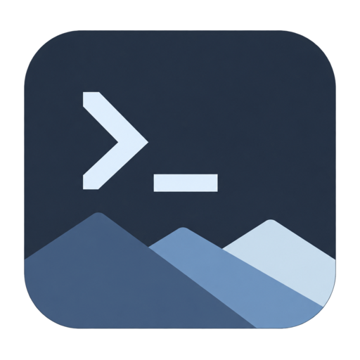
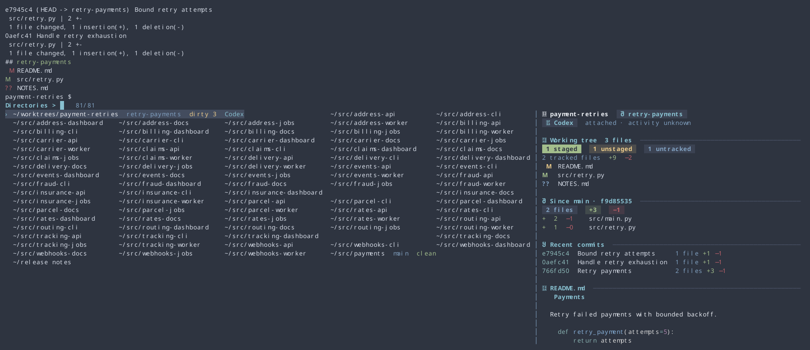

<p align="center">
  
</p>

<h1 align="center">Dotfiles</h1>

<p align="center"><strong>A keyboard-driven workspace for macOS and Linux.</strong></p>
<p align="center">Neovim · Zsh · Kitty · Zellij · Claude &amp; Codex</p>

<p align="center">
  <a href="https://lanej.github.io/dotfiles/">Documentation</a> ·
  <a href="#installation">Get started</a> ·
  <a href="#configuration-sets">Choose your tools</a> ·
  <a href="docs/radar.md">Tech radar</a>
</p>

My daily environment for editing code, navigating repositories, and working with terminal agents. Machine-local TOML selects the tools; Make and symlinks apply their configuration. A shared Nord theme ties the workspace together.

[](docs/directory-picker.md)

**Find the next place to work.** The [directory and worktree picker](docs/directory-picker.md) puts paths, project context, and Git activity together. Its layout adapts as you filter or resize.

## Inside the workspace

| Workflow | What’s included |
| --- | --- |
| **Navigate projects** | `Ctrl-B` / `zz` searches directory history; `Alt-W` / `zw` searches worktrees, with README and Git previews. [Picker guide →](docs/directory-picker.md) |
| **Manage terminal sessions** | Zellij and tmux share a `Ctrl-f` prefix. Zellij adds attention triage, a command palette, a shared popup, and status for local and SSH sessions. [Terminal workflows →](docs/terminal-workflows.mdx) |
| **Edit and review code** | Lua-based Neovim configuration, language tooling, and a GitHub PR review queue with local review worktrees. [Review workflow →](docs/neovim-pr-reviews.md) |
| **Work with agents** | Shared Claude and Codex skills, agent definitions, isolated worktrees, and portable project setup. [Agent configuration →](docs/agent-configuration.md) |
| **Keep tools visually consistent** | Nord colors and shared styling across the editor, terminal, multiplexers, pickers, diffs, and Markdown. [Design system →](docs/design-system.mdx) |
| **Configure each machine** | Reusable tool sets, private overrides, pinned tool recipes, and an inspectable installation plan. [How it fits together →](docs/architecture.mdx) |

## Installation

Requires **macOS or Linux**, with **Git, Make, and Bash** available. This is my personal setup; review the [tool sets](docs/configuration.md) and use the pieces that fit your machine.

### 1. Clone and initialize

```sh
git clone https://github.com/lanej/dotfiles.git ~/.files
cd ~/.files
make base
```

`make base` creates a missing machine configuration and links the native baseline without needing Python.

### 2. Choose your tools

Edit `~/.config/dotfiles/config.toml`. For the broad development environment:

```toml
sets = ["workstation"]
```

The native OS baseline is selected automatically. Use individual bundles or overrides for a smaller setup; see [configuration sets](#configuration-sets).

### 3. Preview and install

```sh
make bootstrap
make plan
make install
```

`make bootstrap` installs uv and Python. **Read the plan before installing**, then open a new shell when setup finishes. The [installation guide](docs/install.md) covers alternate configuration paths, partial installs, recovery, and shell completions.

## Configuration sets

**Select bundles, then override individual tools.** Git, the native OS baseline, and the `shell` and `terminal` sets apply by default. Additional bundles and work context are explicit.

| Select | To add |
| --- | --- |
| `workstation` | Editor, development, AI tools, project setup, and mail and Quarto configuration. |
| `editor` | Neovim, formatters, language servers, and parser tooling. |
| `development` | Language runtimes, Rust maintenance, and development caches. |
| `ai` | Claude, Codex, the worktree manager, and agent status. |

For example, add Mermaid tooling to your selected sets:

```toml
[tools]
mermaid = true
```

Machine properties override the composed sets. Private bundles live in `~/.config/dotfiles/sets/`. `make config` explains the resolved settings and their sources; `make plan` shows what will run. Disabling a tool skips its recipe; it does not uninstall it.

[Full set catalog, work contexts, and overrides →](docs/configuration.md)

## Everyday use

**`make` applies configuration. `make install` installs selected tools and configures them.** Edit files in the checkout; symlinks keep applications pointed at that source.

To update an existing machine:

```sh
cd ~/.files
git pull --ff-only
make
```

Open a new shell to load shell changes. Use `make plan` and `make install` when adding tools.

| Command | Purpose |
| --- | --- |
| `make config` | Show effective settings and where they came from. |
| `make plan` | Preview selected tools and installation steps. |
| `recomp` | Regenerate completions and reload the current Zsh session. |
| `recomp add <tool>` | Register a locally installed CLI’s completion generator. |
| `zj main` | Create or reattach to the `main` Zellij session. |
| `make keybindings` | Inspect the Kitty/skhd keybinding registry. |

## Explore further

| Find | Read |
| --- | --- |
| **Configuration and source files** | [Architecture](docs/architecture.mdx) · [Components](docs/components.mdx) · [Tool catalog](bootstrap/tools.toml) |
| **Platform setup** | [macOS](docs/stack-darwin.md) · [Linux](docs/stack-linux.md) · [Machine migration](docs/install.md#machine-migration) |
| **Terminal controls** | [Zellij](docs/zellij.md) · [tmux](docs/tmux.md) · [Keybindings](docs/keybindings.md) |
| **Agent and project workflows** | [Worktree manager](docs/worktree-manager.md) · [Source-code setup](docs/repository-bootstrap.md) · [Octo Manager](docs/octo-manager.md) |
| **Maintenance and recovery** | [Shared shell history](docs/install.md#shared-shell-history) · [SSH approval status](docs/intent-ssh.md) · [Project updates](docs/project-updates.md) |

Changes and experiments are frequent. The [tech radar](docs/radar.md) records what I use, what I’m evaluating, and why.

For changes to this repository, start with [AGENTS.md](AGENTS.md) and the [PR guidance](docs/pull-requests.md). The [documentation maintenance guide](docs/documentation-site.mdx) explains how the shared sources become the published site.
