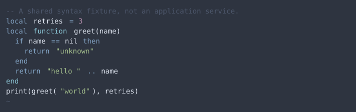
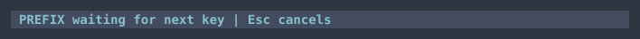
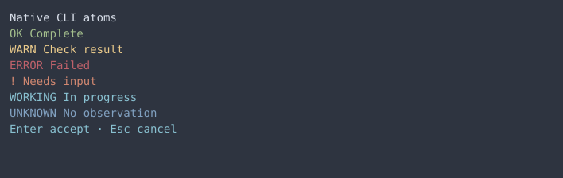
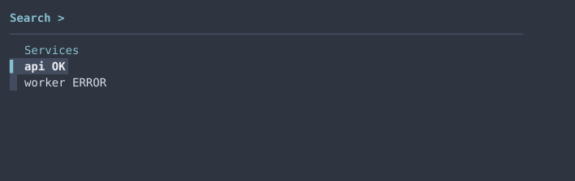
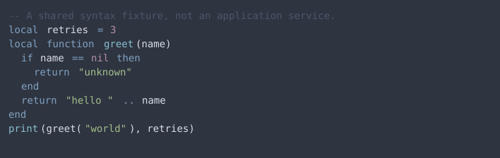
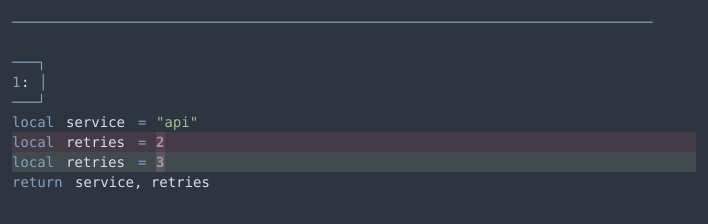
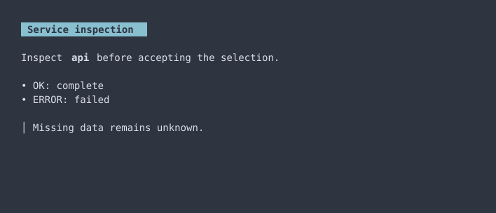

import ThemeCatalog from '@components/ThemeCatalog.astro';

One theme definition supplies native implementations across the terminal environment. Atomic levels organize the catalog; application code stays grouped by capability. Nord is the first steel thread, establishing a baseline before a personal green theme is designed.

Jump to [theme roles](#theme-roles), [presentation tokens](#presentation-tokens), the [atomic catalog](#atomic-catalog), or [integration boundaries](#integration-boundaries).

## How the system fits together

The source chain is **palette → semantic roles → component roles → native mappings**. [Preset selection](../design-system/config.json) chooses the input; `--theme` overrides it for an experiment. Runtime filenames, theme identifiers and adapter mappings stay independent of that choice. The status broker supplies state names; the generated tmux adapter resolves their presentation locally, ignoring producer-supplied colors. [Shared tokens](../design-system/tokens.json) own reusable aliases, blend recipes and typed presentation defaults. The [Nord definition](../design-system/themes/nord.json) assigns palette values; [component definitions](../design-system/components.json) describe presentation roles. Adapters translate those definitions into each host's native vocabulary. There is no universal widget runtime and no dependency on Charmed or Easy UI.

Nord's sixteen base colors follow the [official palette and usage guidance](https://www.nordtheme.com/docs/colors-and-palettes/). Surfaces use Polar Night, text uses Snow Storm, primary accents use Frost, and statuses use Aurora. Application-specific mappings are our policy. Diff backgrounds blend their semantic color into the base surface at 16%, with 30% for emphasized changed words; staged signs use a 55% blend. Those are explicit recipes, not extra undocumented Nord colors.

The theme distinguishes selected rows, active tabs, warnings, errors, success, attention and unknown observations. Status retains a label or glyph. Syntax grammars can differ across hosts; matching semantic roles does not promise identical token classification.

Kitty opacity remains `0.97`; Neovim's main background remains inherited. The theme defines solid surfaces for popups, selections and other native components. Transparent compositing depends on the terminal and desktop behind it; saved captures show the solid theme backing.

## Presentation variants

Presets can override presentation without changing native adapters. Boolean emphasis, single-line symbol strings, and nonnegative integer spacing are typed. Spacing declares `cell` or `row` units; an adapter must explicitly support the unit. Current inline padding consumers use cells. These terminal units are separate from the website’s CSS pixels.

```json
{
  "presentation": {
    "emphasis.heading": false,
    "space.inline": 2,
    "symbol.git.file.modified": "M"
  }
}
```

Add this optional object to a preset. Override values retain the shared declaration’s type and unit; aliases use `{ "token": "another.declared.token" }`. Component/native references use the same explicit token object. A cell dimension becomes native text padding only through `{ "token": "space.inline", "as": "spaces" }`. Missing references, cycles, incompatible types or units, and unsupported native syntax fail before generated files are written.

Heading emphasis reaches Neovim and Glow; Glow’s sixth-level heading stays subdued. Inline padding reaches Glow code spans and tmux’s session label. Powerline separators reach tmux and lualine. Git file status icons feed Starship’s native modules, preserving counts and ahead/behind composition. Unstaged, staged and branch-comparison gutter signs have separate token names and preserve their existing defaults. Empty symbol strings are allowed, including Starship’s count-only staged indicator. Nerd Font availability and native glyph widths remain host constraints; Neovim rejects gutter symbols wider than two display cells.

Starship’s complete configuration is generated from a native template; its existing configuration path remains stable. Other prompt-module symbols stay application specific. The catalog lists direct consumers and exceptions. Generated `tokens.json` records defaults, overrides and resolved values; existing `colors.json` consumers retain their color interface. Neovim and Python exports also expose resolved presentation values.

## Generate, configure and reload

```sh
make theme-generate  # compile committed native artifacts
make theme-check    # validate sources and detect stale artifacts without writes
make shell kitty tmux-config vim-config zellij
make theme-cache    # refresh bat's cache, also consumed by delta
```

For the initial Zellij migration, build the changed status plugin with `make zellij-status zellij`. Subsequent palette changes use native KDL theme styles; the status renderer no longer embeds the theme RGB values. Runtime installation remains explicit and separate from theme generation.

Use Kitty's existing Cmd+Shift+R binding, `:colorscheme dotfiles` in Neovim, and `tmux source-file ~/.config/tmux/tmux.conf`. Reopen pickers and pagers; restart bottom. Start a new Zellij session if its native watcher does not reload a theme-file edit. The main tmux config reload refreshes existing agent segment colors without resetting their state age. There is no coordinated live-switch guarantee.

For an isolated theme experiment, run `python3 scripts/theme.py --theme nord --output-dir /tmp/my-theme`. `DOTFILES_THEME_DIR` selects alternate generated artifacts for the native fixture runner and owned Python/Neovim/fzf consumers; it does not select a theme globally across running applications. Generated files carry native formats and require no generator during normal startup.

## Native examples

These images render captured application cells, including foreground, background and emphasis. They are saved examples, not interactive previews or HTML imitations of application widgets. The JSON baselines retain attributes beyond those visible in a screenshot. Native captures use isolated homes and caches; they do not contain live session data.















Neovim baselines inspect resolved native highlights after loading the real Gitsigns, lualine and fzf-lua plugins and after reloading the colorscheme. The existing Zellij status workflow checks actual rendered prefix and attention states. These checks complement the saved pager examples; they do not establish every enabled plugin's interactive appearance.

<ThemeCatalog />

## Regression workflow

```sh
make test-theme
make test-theme-native
make test-theme-presentation
make test-zellij-status test-zellij
```

The first check validates definitions, composition, deterministic generation, wiring, failures and plain output. Native checks require Kitty’s CLI, Neovim, tmux, fzf, bat, delta, Glow, bottom, the pinned Zellij runtime and built status artifact, and the three pinned Neovim plugins from `nvim/lazy-lock.json`; `--surface` can run a single integration. The fixture runner uses uv and pyte. Presentation checks additionally require Starship 1.27.0 and exercise disposable Git repositories and native reloads. The full Zellij workflow checks additionally need the pane-navigation artifact described in the [Zellij guide](./zellij.md).

The [pre-migration settings](../design-system/baselines/pre-migration.json) and [Neovim observations](../design-system/baselines/pre-migration-neovim.json) preserve the old customized appearance. Intentional normalization replaces the non-Nord Kitty selection, extra bright ANSI colors, purple primary focus, and hand-picked Git diff backgrounds. Regression baselines are named for their preset; the native runner selects the baseline directory from generated theme metadata. That metadata records provenance, not runtime dispatch. The new canonical baseline is independent of generated files: `theme-generate` never changes it.

To intentionally replace native baselines, run `uv run --script scripts/test-theme-native.py --record` and inspect both the JSON diff and images. A recorded baseline is a candidate until reviewed; recording is not user approval. Version changes and volatile layout must be investigated before accepting a new baseline. A changed shared role or native highlight mapping must fail the affected detector.

## Adding a component or integration

Add its purpose, atomic level, composition, implementations and source locations to [the catalog](../design-system/catalog.json). Use existing roles where meanings agree; add a distinct role when a meaningful state would otherwise be lost. Keep application-specific field names in adapters. Supported native configuration takes precedence over patches or replacements.

Document unavailable customization in [the integration inventory](../design-system/integrations.json), including the owning application or plugin and what remains unverified. Verbatim pane output, literal color previews and filetype icon colors have independent owners. Optional applications are listed as gaps rather than silently claimed as migrated.
