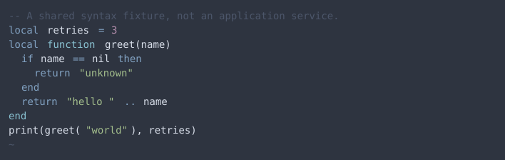
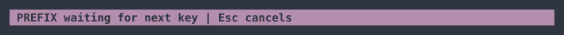
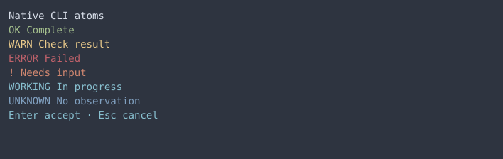
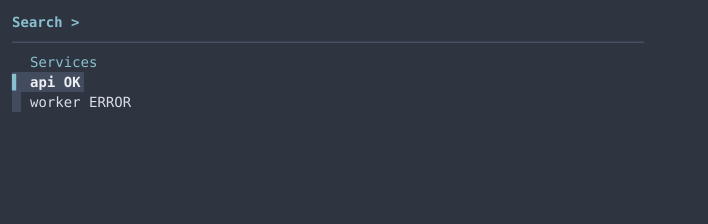
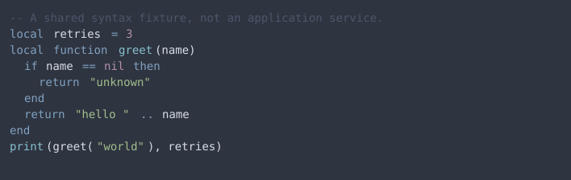
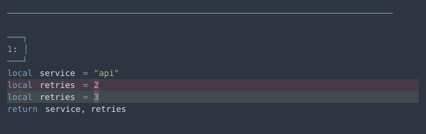
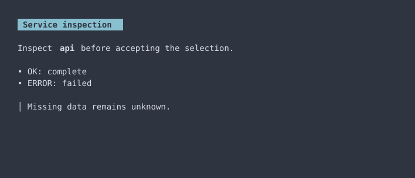

import PresetPalette from '@components/PresetPalette.astro';

Nord is the initial built-in preset for the [terminal design system](../design-system.mdx). It supplies palette values and semantic color assignments; shared tokens, components and native adapters remain reusable across presets. The [preset input](../../design-system/themes/nord.json) identifies its source and defines its ANSI slots. It currently inherits the shared presentation defaults without overrides.

Its sixteen base colors follow the [official Nord palette](https://www.nordtheme.com/docs/colors-and-palettes/): Polar Night for surfaces, Snow Storm for text, Frost for accents and Aurora for status. The application mappings are this repository’s policy. Shared diff recipes blend semantic colors into the surface at 16%, emphasized changed words at 30%, and staged signs at 55%; those recipes belong to the design system rather than the Nord palette.

<PresetPalette preset="nord" />

## Select this preset

Choose `"theme": "nord"` in [preset selection](../../design-system/config.json), then run `make theme-generate`. For an isolated output, use `python3 scripts/theme.py --theme nord --output-dir /tmp/nord-preset`. Apply configuration and use the native reload instructions in the [design-system guide](../design-system.mdx#generate-configure-and-reload).

## Native examples

These images render captured application cells, including foreground, background and emphasis. They are saved examples, not interactive previews or HTML imitations of application widgets. The JSON baselines retain attributes beyond those visible in a screenshot. Native captures use isolated homes and caches; they do not contain live session data.

Neovim baselines inspect resolved native highlights after loading the real Gitsigns, lualine and fzf-lua plugins and after reloading the colorscheme. The existing Zellij status workflow checks actual rendered prefix and attention states. These checks complement the saved pager examples; they do not establish every enabled plugin's interactive appearance.

## Baseline

The [pre-migration settings](../../design-system/baselines/pre-migration.json) and [Neovim observations](../../design-system/baselines/pre-migration-neovim.json) preserve the old customized appearance. Intentional normalization replaces the non-Nord Kitty selection, extra bright ANSI colors, purple primary focus, and hand-picked Git diff backgrounds. The independent JSON baselines live under `design-system/baselines/nord/`. Native captures are stored under `docs/design-system/presets/nord/`, so recording another preset cannot replace these examples.
