# Sage Midnight in Atuin, Neovim and bat

These terminal frames come from the [final terminal design system run for #427](https://github.com/lanej/dotfiles/actions/runs/45862016087). The CI checkout was `e36c27c7` for PR head `2a933d89`. Each SVG matches the corresponding file in the [native capture archive](https://github.com/lanej/dotfiles/actions/runs/45862016087/artifacts/15139121005).

## Atuin history search

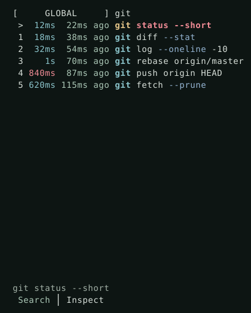

## Code by language

Each pair shows the same retry-policy source in Neovim and bat. The Neovim frame includes a warning diagnostic.

Rust

**Neovim**

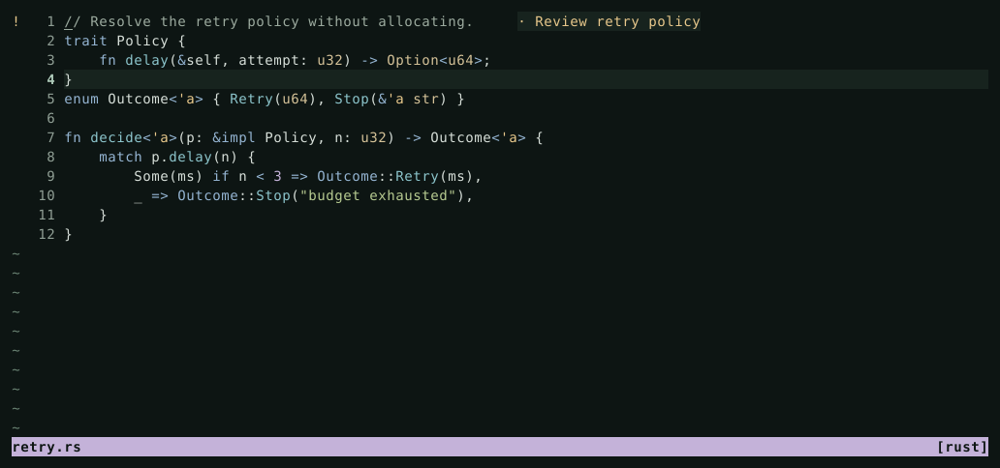

**bat**

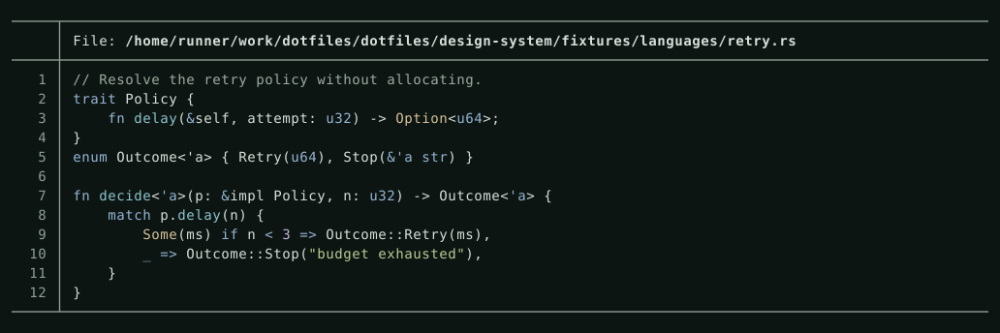

Go

**Neovim**

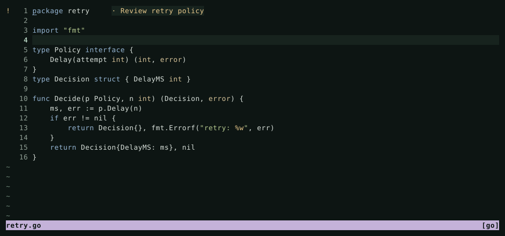

**bat**

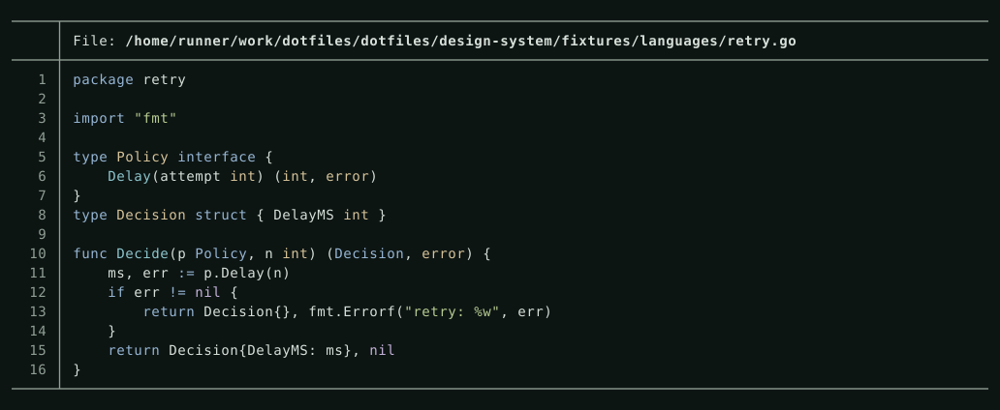

TypeScript

**Neovim**

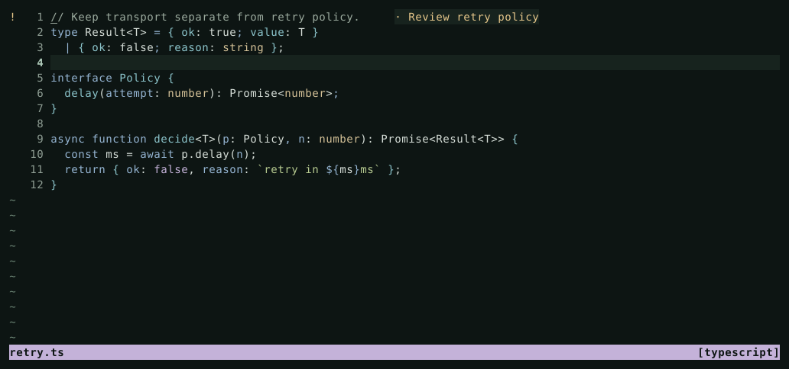

**bat**

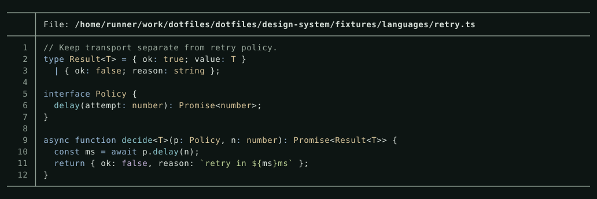

Python

**Neovim**

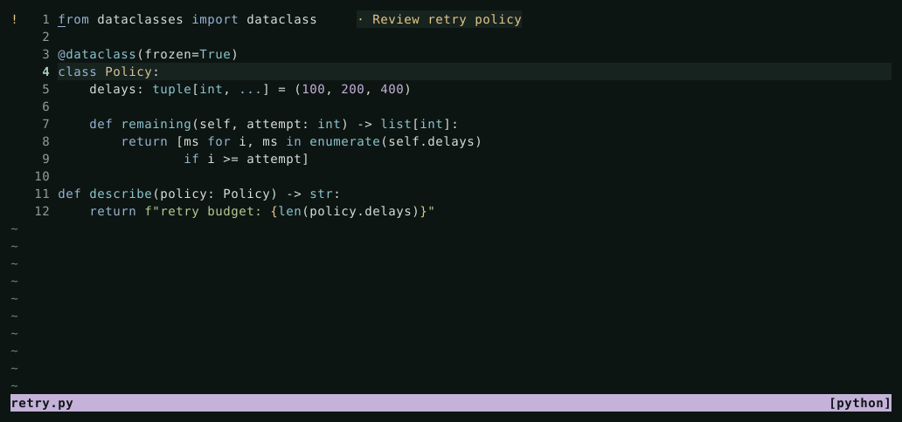

**bat**

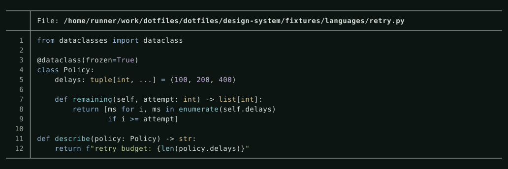

Ruby

**Neovim**

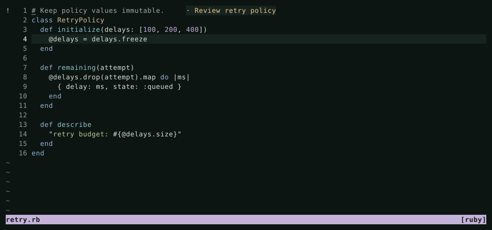

**bat**

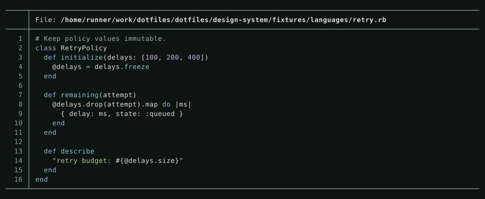

Lua

**Neovim**

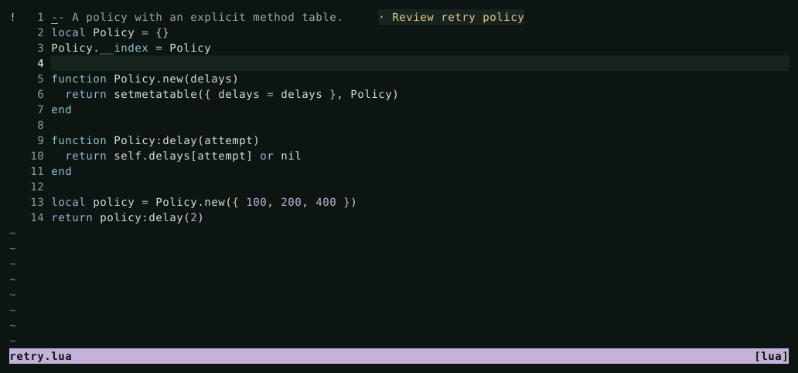

**bat**

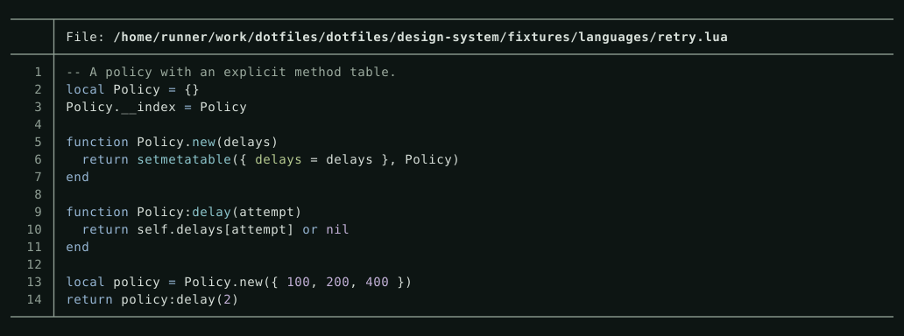

Bash

**Neovim**

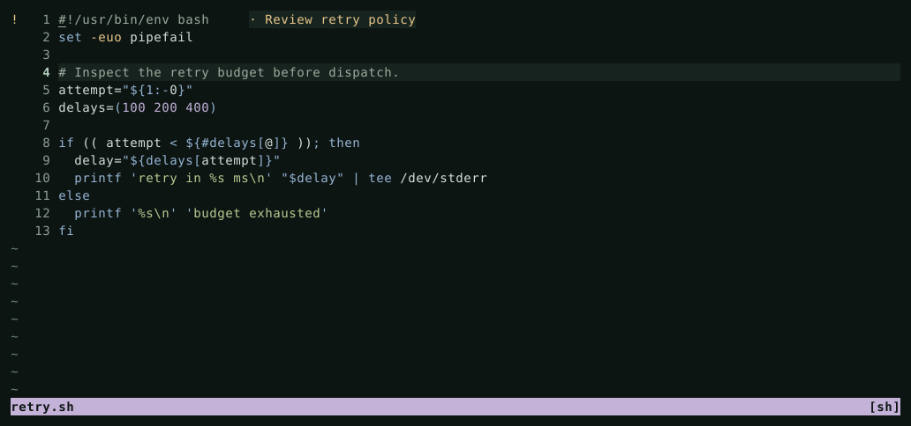

**bat**

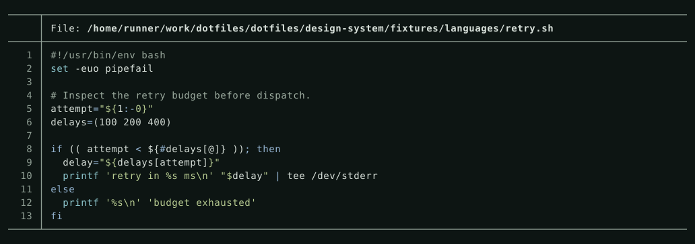

JSON

**Neovim**

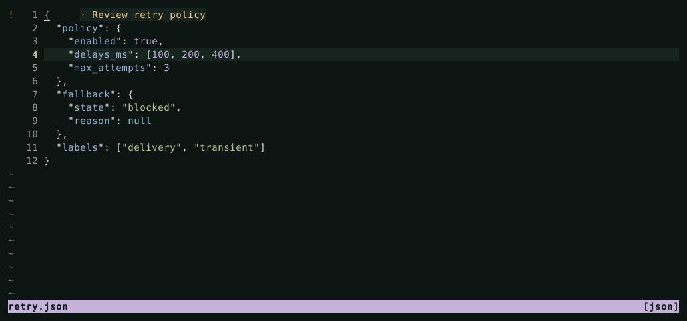

**bat**

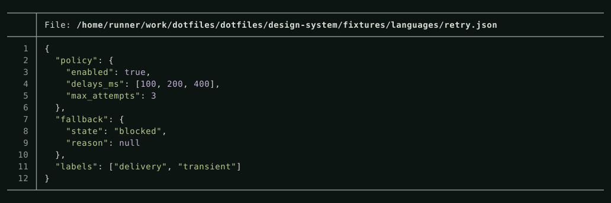

TOML

**Neovim**

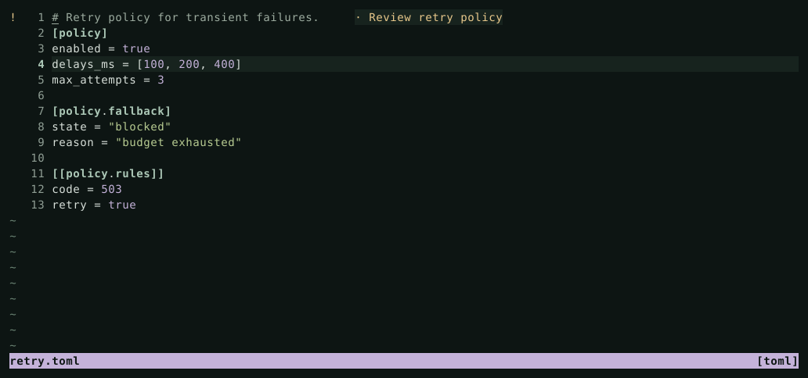

**bat**

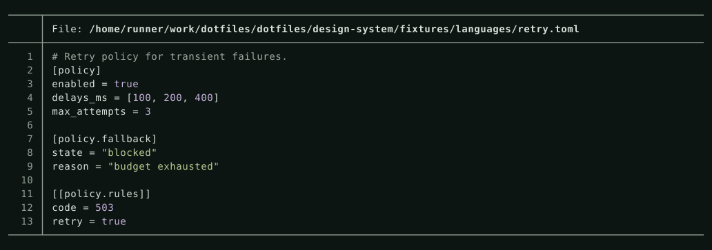

