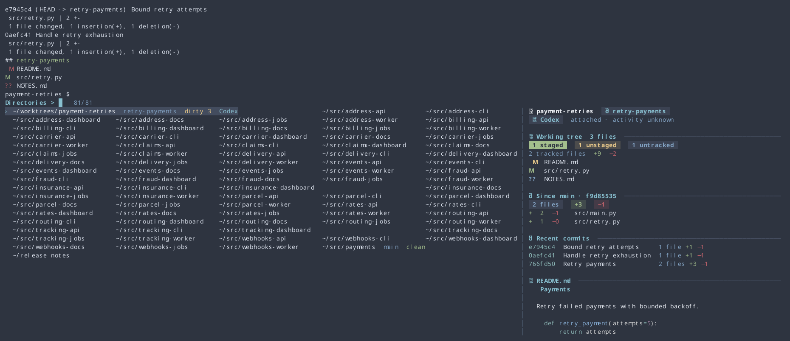
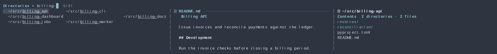
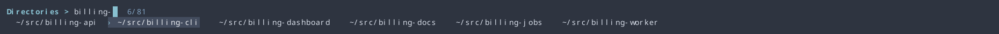
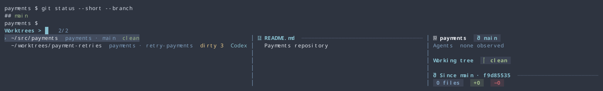
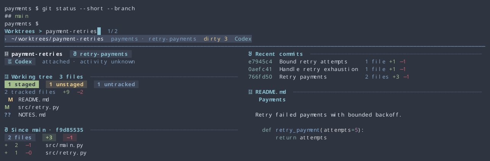
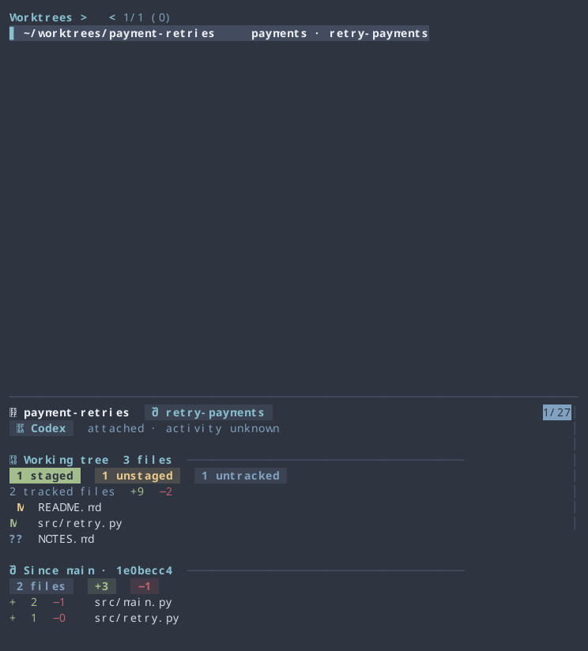
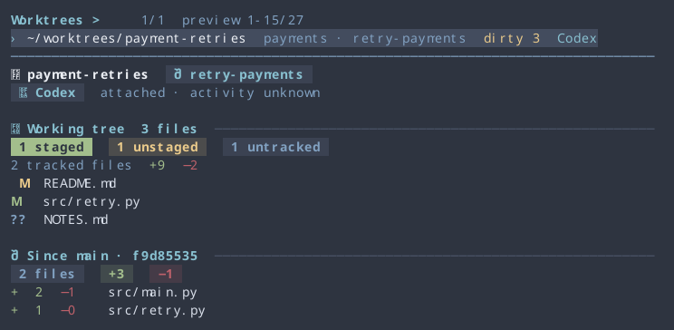

# Directory and worktree jumps

Press **Ctrl-B** or run `zz` to search directory history. Press **Alt-W** (**Option-W** on macOS) or run `zw` to search registered Git worktrees. Both pickers change the current shell directory after selection. Cancel with Escape or Ctrl-C; the directory and any unfinished command remain intact.

Inside a repository, `zw` lists that repository’s worktrees. Outside a repository, it finds repositories immediately under the current directory and lists their worktrees, including worktrees stored elsewhere. Rows show the repository and branch, identify detached heads and locked worktrees, and omit missing directories. Discovery is read-only.

The Charmed picker opens inline in the shell. Matches run left to right in rank order. Column spacing comes from the paths on screen, and a long or annotated entry spans extra columns in its own row. A handful of short matches can fit on a single line. As you filter or resize, the picker releases unused rows and keeps the highlighted path selected while it still matches. Repository roots show the branch, working-tree status and attached terminal agents. Type `Codex dirty` to search those details as they arrive.

The preview can sit beside a dense grid or immediately below a short list. Git details appear while the terminal agent check is running. The preview shows staged, unstaged and untracked files, the committed changes since the merge base, up to five recent branch commits with per-commit file and line counts, and the rendered README. A wide preview can put complete sections side by side. In a short pane, the line range beside the query shows how far you can scroll with Ctrl-J and Ctrl-K. README input is bounded to 64 KiB. Markdown uses the shared Glow theme, with bat and plain text as fallbacks.

Outside a repository, the preview shows the selected directory’s contents using eza or a plain listing. An empty directory takes no preview space by default. Ctrl-/ can display it explicitly.

The comparison base uses the local `origin/HEAD` reference when available, otherwise local `main` or `master`; no fetch is performed. The preview names the actual reference and merge-base commit. Uncommitted changes and committed branch changes remain separate; untracked contents are not included in line totals. If a base or statistic cannot be read, it is shown as unavailable.

Agent presence is a snapshot of live tmux/Zellij panes taken when the picker opens, matched to the selected Git worktree. A running agent client establishes attachment; it does not establish an active turn. The current terminal hooks do not expose reliable activity for each agent, so activity remains unknown. Codex desktop chats and agents outside these terminal sessions are outside this observation scope.

| Key | Action |
| --- | --- |
| Up / Down | Move to the nearest column in the row above or below |
| Left / Right | Move between matches on the current row |
| Ctrl-P / Ctrl-N | Move to the previous or next match in rank order |
| Page Up / Page Down | Move a page of rows |
| Enter | Jump to the highlighted directory |
| Ctrl-Space | Keep only the current matches and start a fresh search |
| Ctrl-/ | Show or hide the preview |
| Ctrl-J / Ctrl-K | Scroll the preview |
| Escape / Ctrl-C | Cancel |

Run `zz search terms` or `zw search terms` to start with a query. Filtering uses fzf query syntax over the path label and available row details. If `shortpath` is available, labels shorten parent components while keeping the last two components readable; otherwise they use full paths with `~` for the home directory. Abbreviations are display labels only: selection always retains the original path. History is ordered by the score from `_z -l`, with shorter paths first on ties. Worktrees retain Git’s ordering within each repository.

The shell set builds the native UI during `make install`. To build or update just the picker in an existing checkout, run `make directory-picker` with Go available. Both commands use Python 3 and fzf. A checkout without the native binary uses the previous interactive fzf picker.

Run `make test-directory-picker` for shell-jump and Git-discovery checks. After building the UI, run `uv run --script scripts/test-directory-picker-native.py` to exercise the actual Ctrl-B and Alt-W bindings and capture the following terminal views.

