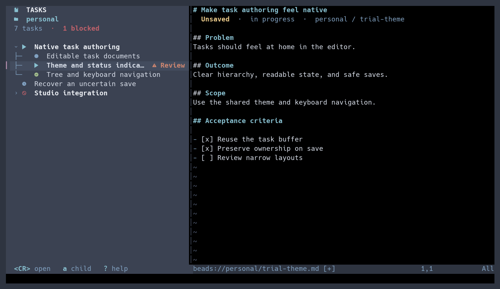

# Beads tasks in Neovim

`:Beads` opens a persistent task explorer beside ordinary editable Markdown documents. Browsing, creating, editing and saving tasks work without chat or a Pi worker. The [Beads service](beads.md) owns durable task state; saving never dispatches work or records a planning/review approval.

## Configuration

Set `vim.g.beads` before loading the dotfiles configuration, or call `require("beads").setup(...)` explicitly after startup. No service is contacted at startup. Projects are explicit and independent of the source checkout or current working directory:

```lua
require("beads").setup({
  default_project = "personal",
  projects = {
    personal = {
      url = "http://127.0.0.1:8790",
      project_id = "your-project-uuid",
      -- prefix = "octo", -- Required if issue_prefix is unavailable from the API.
      -- token_file = "/absolute/path/to/token",
      -- actor = "nvim",
    },
  },
})
```

Use the project ID reported by `GET /v0/beads/context`. The client requires the configured project, Dolt server backend and necessary capabilities to match; it does not adopt a different workspace automatically. Remote HTTP requires a loopback tunnel; non-loopback services require HTTPS. Token files are read for requests and excluded from command arguments and error messages. The explorer uses Neovim, curl and the pinned Nui library already installed by this configuration; the existing Markview setup supplies Markdown previews. Changing an already configured project's authority requires restarting Neovim.

## Navigation

| Command | Action |
|---|---|
| `:BeadsProjects` | List sorted configured project names; `*` marks the current project. With none configured, show configuration guidance. |
| `:Beads [project]` | Open or focus that project's persistent explorer; complete configured names by prefix. |
| `:BeadsOpen [id]` | Open a task in a normal editing window; reuse its buffer across windows/tabs. |
| `:BeadsNew [parent-id]` | Open an unsaved root or child draft. |
| `:BeadsRefresh` | Refresh the graph while preserving expansion, selection, focus and dirty documents. |
| `:BeadsRelationships` | Inspect incoming/outgoing relationships and open a linked task. |
| `:BeadsStatus status` | Explicitly change status under revision and server policy checks. |
| `:BeadsRecover` | Open a durable pending-creation draft for reconciliation. |
| `:BeadsReload[!]` | Reload an existing task's latest document/revision; `!` explicitly replaces unsaved text. |

Commands without an explicit project use the current Beads document or explorer's project before the global active/default project. Opening an explorer changes the global active project; listing and completion do not. `:BeadsOpen` and `:BeadsNew` complete sorted, literal-prefix IDs from that project's cached graph only. Candidates are empty before a successful refresh; a failed refresh retains the previous cache. Manually typed IDs need not be cached. Listing shows names only, never URLs, credentials or database discovery results. Neither listing nor completion reads tokens, contacts services, creates explorers or discovers databases.

`nvim/init.lua` registers these commands eagerly, before Lazy setup, including with no configured projects. Project-name completion is available before opening any explorer; there is no separate lazy command loader.

In the explorer use `j`/`k` to move, `l` to expand, `h` to collapse or move to the parent, Tab to toggle, Enter/`o` to open, `a` to create a child, `A` to create a root, `s` to enter a status, `gr` for relationships, `r` to refresh and `q` to close the explorer. Blocker links are independent of nesting. Containment does not indicate readiness or authorize child dispatch. Orphans and cyclic containment remain inspectable with warnings.

Filled status icons identify tasks: `` open, `󰐊` in progress, `` blocked, `󰥔` deferred and `` closed. Custom states retain their names. Task state comes from Beads. There is no stock attention field shared by every controller: an optional project `attention = function(task) ... end` can return a compact label from the controller-owned metadata available in that project. Returning nil displays no signal; status and attention never substitute for runtime admission checks.



[The 64-column capture](screenshots/neovim-beads/64-columns.png) exercises the same split and editable document at a narrower width. These grid reconstructions use the full Neovim configuration and installed plugins, with transparent cells composited against the configured Kitty background. They preserve RGB highlight attributes and bold Nerd Font glyphs; they do not capture terminal window chrome.

## Appearance

Beads keeps its tree and task panes outside focus.nvim automatic resizing so the sidebar stays fixed and narrow layouts can open below the normal editor-window minimum. Other buffers retain the configured focus behavior.

The sidebar uses the pinned [Nui tree component](https://github.com/MunifTanjim/nui.nvim/tree/main/lua/nui/tree) for task nodes, with file-browser conventions familiar from nvim-tree: disclosure arrows, branch guides, emphasized parents and a distinct selection. The fixed-width panel has a project summary, keyboard hints and visible loading/stale states. Long titles are clipped at character boundaries to fit the panel; open the document to read the full title and task identity.

The sidebar inherits the editor’s `Normal` background, including transparency. Foreground highlights resolve through the shared dotfiles theme’s semantic roles and survive colorscheme reloads. Status and attention have separate colors. Icons use the terminal’s Nerd Font; the editor configuration uses Hack Nerd Font Mono. Markview renders the document’s ordinary Markdown headings, checkboxes, links and other content using the existing editor configuration. Beads adds only managed task/save context and hides its persistence boundary. The context shows saved, unsaved, failed or pending-creation state. Word-boundary wrapping and conceal settings are restored when the window returns to a different buffer.

## Editing and explicit saves

The first line is `# Title`. Text below it and above the generated `<!-- beads:acceptance:v2:… -->` boundary maps to the description. The boundary is followed by a real `## Acceptance criteria` Markdown heading; text below that heading maps to `acceptance_criteria`. New drafts include problem, outcome, scope, constraints and source-link headings. Existing headings, fenced examples and trailing newlines round-trip without being reinterpreted as fields. Markview supplies the Markdown presentation; Beads conceals only the managed boundary. `:setlocal conceallevel=0` reveals its exact marker if it needs repair. Preserve the unique boundary and its following heading when editing; invalid delimiters fail validation before any write. Pending drafts from the earlier boundary-only format remain readable and retain their original field mapping.

Use `:write` to save. Identity, revision, parent and runtime ownership are managed separately from Markdown. A child draft has no bound Bead ID until the first successful save atomically creates the task and its parent link. Later saves update the same identity with revision checks and preserve assignee, attempt and unrelated metadata. Editing a claimed brief changes the revision, so the existing runtime's accepted-brief checks refuse stale work. Status changes are separate actions and honor close/blocker policy without force overrides.

Switching nodes, hiding/closing the explorer or closing a separate chat neither saves nor discards document text. Normal hidden buffers retain edits; explicit forced buffer deletion or quitting Neovim can discard ordinary unsaved text. A refresh updates the graph only. If text changes while a save runs, the newer text stays modified and requires another explicit save.

## Conflicts and uncertain creation

A failed or conflicting save retains edits and the original revision. Compare the task's current state before resolving the conflict; copy the local text to a separate ordinary buffer/file if needed, then use `:BeadsReload!` to deliberately replace the document with its latest remote revision. Apply the intended changes to that refreshed document and save again. Refresh never silently rebases a dirty document.

Before creation, the editor writes a private receipt under `stdpath("state")/beads`. After a lost response, `:write` on that draft or `:BeadsRecover` after restart only reconciles the recorded operation; it never sends another create request. Successful reconciliation requires the same project, operation marker, parent and submitted authored fields. Local edits made after submission remain modified.

Missing tasks, unavailable reads, mismatched markers/parents or intervening remote edits leave the draft and receipt pending for manual inspection. A missing task does not prove creation never committed. Inspect the target through the configured service and preserve the receipt/draft while resolving the outcome; do not delete the receipt merely to retry. The receipt stores the submitted text, not a crash-proof journal of subsequent unsaved keystrokes. A confirmed no-write server refusal permits a corrected explicit save.

## Development checks

`nvim --headless -u NONE -i NONE -n -l nvim/tests/beads-completion.lua` exercises real command registration/execution and `getcompletion` without plugins or network. Its controlled in-process store supplies distinct project graphs via real refresh, including before explorer creation. It checks empty/single/multiple configurations, context precedence, literal prefixes and passive-operation call/buffer invariants. Only the explorer portion suppresses Nui rendering; it does not stand in for full startup or visual acceptance.

The separate external gates are the pinned-Nui HTTP journey, `make check-beads-lua`, full disposable `nvim/init.lua` startup, and actual keyboard Tab plus empty/populated rendered output with retained visual evidence. The HTTP journey requires loopback and installed locked dependencies and is not part of isolation.

[Project listing at 120 columns](screenshots/neovim-beads-projects.png) and [task completion at 64 columns](screenshots/neovim-beads-completion.png) show native Neovim grid captures from the complete configuration with lockfile plugin revisions. The narrow capture shows the cached task selected in Blink’s menu; pressing Tab inserts its ID while remaining on the command line without submitting. The repository renderer draws the captured cells with Hack Nerd Font Mono and composites transparency against the configured Kitty background; these are editor-grid reconstructions, not desktop screenshots.

`make test-nvim-beads` exercises public editor commands against a controlled HTTP boundary, including lost responses and recovery in a new Neovim process. It uses the installed Nui checkout at the lockfile revision; set `NVIM_TEST_NUI=/path/to/nui.nvim` to select another checkout of that same revision. `make check-beads-lua` checks generated binding freshness after `npm ci --prefix tools/task-runtime`. Regenerate using `npm --prefix tools/task-runtime run generate:beads-lua`; keep the schema and both generated clients synchronized when updating Beads.

`make test-nvim-beads-presentation` checks actual Markview attachment, heading rendering and a save from the rendered task buffer. It uses Neovim’s bundled Markdown parsers and the lockfile’s Markview revision; set `NVIM_TEST_MARKVIEW=/path/to/markview.nvim` to select that checkout.

For native compatibility, use a [Studio source checkout](https://github.com/lanej/studio) with a Bun runtime satisfying that checkout's declared requirements and locked dependencies installed, then run `make test-nvim-beads-native STUDIO_TEST_SOURCE=/absolute/path/to/studio BEADS_TEST_BD=/path/to/pinned/bd BEADS_TEST_DOLT=/path/to/pinned/dolt`. The harness imports Studio’s isolated fixtures and runtime guard directly; CI pins that public source checkout to a specific commit. The native check creates disposable task storage, verifies atomic relationships and guarded saves, and checks that editing claimed work preserves ownership while the existing runtime rejects the old accepted brief. It never targets the installed task service.

`uv run --script scripts/capture-nvim-beads.py` reproduces the normal and narrow RGB captures using the same disposable HTTP fixture. It loads this checkout’s complete `nvim/init.lua` with the installed plugins, rather than assembling a separate editor profile. Override `--terminal-theme`, `--fonts` or `--output-dir` as needed; `--terminal-theme` defaults to the installed Kitty theme, and `--fonts` expects the regular and bold Hack Nerd Font Mono files.
