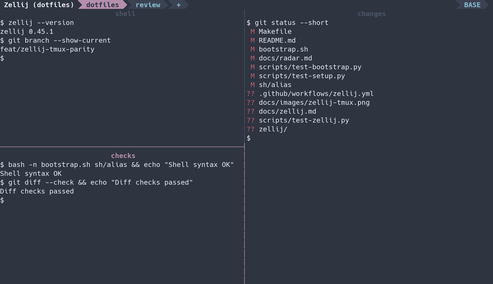

# Zellij with the tmux bindings

An opt-in Zellij configuration that follows [the existing tmux setup](../rc/tmux.conf): `Ctrl-f` prefix, Vim-style splits and navigation, a single top tab bar, and the Nord purple/cyan palette. The terminal normally stays in locked mode, with bare Ctrl-h/j/k/l reserved for smart pane navigation.



Terminal capture of this configuration running on Zellij 0.45.1.

## Start a session

Use the **pinned [lanej/zellij fork](https://github.com/lanej/zellij)** installed by this checkout, Python 3 for the configuration helpers, fzf, and Rust through rustup. The selected Zellij recipe defaults to the exact fork revision in [`scripts/install-zellij`](../scripts/install-zellij). The fork builds on upstream `main` at `bf517077`, which includes [OSC 7501 support](https://github.com/zellij-org/zellij/pull/5734) and the startup repair; it carries the CLI completion, shutdown flush, and initial-client registration fixes with their native regressions. Select the runtime explicitly through [configuration sets](../README.md#configuration-sets): `tools.zellij = true` enables the recipe; `zellij.source = "patched"` installs the fork, `"release"` installs upstream stable, and `"main"` builds pinned upstream main without the fork's fixes. The `terminal` and `workstation` bundles enable Zellij. The main and release choices omit the fork's fixes; the documented popup, query, and shutdown acceptance applies to the patched runtime. The native builds use Rust 1.95.0 without changing your default toolchain. Neovim is used to edit scrollback. Return the default pin to a stable release once it includes OSC support and these reliability fixes; the status bar uses its native attention protocol.

The first native build takes longer than installing an upstream binary and needs a C/C++ compiler, Make, CMake, pkg-config, and OpenSSL development files. `make install` installs those build dependencies when Zellij is selected. On macOS, install Xcode command line tools and run `brew install cmake pkg-config openssl@3 fzf`. Cargo uses the fork's lockfile and caches compilation artifacts under `${XDG_CACHE_HOME:-$HOME/.cache}/dotfiles/zellij/target`. Each fork installation replaces the executable, including binaries left by the previous installer, while reusing the build cache. Cargo manages installation ownership and locking. The stock Homebrew or upstream 0.45.1 executable does not include these fixes.

The fork also preserves the initial terminal client's registration when a temporary CLI connection closes before the first layout. A client that really disconnects remains absent when that late layout finishes. Existing session servers need a restart to use this repair.

From the dotfiles checkout:

```sh
make zellij-runtime zellij
zellij attach --create main
```

`make config` shows the selected source before installation. `make zellij-runtime` installs that runtime, replacing the managed executable even when switching from a newer development version back to stable. `make zellij` installs configuration and helpers without installing software or starting a session. Without a built bar, or with an older runtime, it selects the built-in tab bar and compatible keys. `make install` builds the native-attention bar for the patched/main runtime and reapplies configuration; `make zellij-status zellij` explicitly does the same on an existing installation. The bar uses Rust 1.95.0 and `wasm32-wasip1`; pass `ZELLIJ_STATUS_WASM=/absolute/path/lane-status.wasm` to use an already-built bar. `make configure` also applies this configuration when Zellij is selected. Setup records Zellij's native "never show again" choice for its configuration wizard, preserving other desktop settings, so the wizard does not block the managed keybindings on first launch. In a new shell, `zj main` is the short form of the attach-or-create command. Configuration and individual layouts are symlinked, preserving additional user layout files.

Restart existing session servers to use the fixes: replacing the executable does not replace a running server. Keep `$HOME/.local/bin` before package-manager directories in `PATH`. The fork reports the pinned upstream version, `0.46.0`, and includes its matching bundled plugins.

On first launch, the bar asks for permission to read application state, run its local helpers, switch tabs or detach a client, write to pane input, configure each client's runtime paste binding, exchange messages with its clipboard receiver, and receive CLI messages from the client chooser. Focus that permission prompt with **Ctrl-f k**, then press **y**. Zellij remembers the grant for this plugin. The bar becomes unselectable after permission is granted. An existing installation may ask again when these permissions expand.

Use `Ctrl-f d` to detach and run the same attach command to return. Closing the terminal also detaches. Existing tmux configuration and shell startup are unchanged. [Firstmate can explicitly select Zellij](firstmate.md) through `FM_BACKEND=zellij` or its backend configuration; its default remains tmux.

## Familiar keys

Every key below follows **Ctrl-f**, unless stated otherwise. `Esc` cancels prefix mode. Most actions return immediately to locked mode.

| Key | Action |
| --- | --- |
| `f` | Send a literal Ctrl-f to the application |
| `Ctrl-f` | Fuzzy tab picker, with native attention first and pane previews |
| `Ctrl-a` | Focus the next native attention item across sessions |
| `Ctrl-w` | Fuzzy picker for running sessions, with a tab-tree preview |
| `h`, `j`, `k`, `l` / arrows | Focus the adjacent pane |
| `Tab`, `o` | Focus the next pane |
| `;` | Focus the previously focused pane |
| `s`, `"` | Split below, inheriting the working directory |
| `v`, `%` | Split right, inheriting the working directory |
| `c` | New tab |
| `Ctrl-n`, `n` | Next tab |
| `Ctrl-p` | Last-focused tab |
| `r`, `,` | Rename the tab; Enter accepts and Esc restores the name |
| `0`–`9` | Select the tab at that zero-based position |
| `d` | Detach, keeping the session running |
| `D` | Choose one attached client to detach; Enter confirms and Esc cancels |
| `x` | Close the focused pane |
| `z` | Toggle pane zoom |
| `Z` | Toggle zoom without the surrounding UI |
| `J`, `K` | Move the pane down/up |
| `<`, `>`, `+`, `-` | Resize toward left/right/up/down |
| `Ctrl-r` | Enter repeatable resize mode |
| `Space`, `Ctrl-o` | Next/previous columns, rows, stacked, or equalize layout |
| `P` | Open the shared persistent popup; the same key inside it hides that view |
| `F` | Show/hide the current tab's other floating panes |
| `Ctrl-q` | Confirm shutdown of the current Zellij session |
| `u`, `i` | Return to a containing Zellij session / enter the focused nested session |
| `!` | Move the focused pane to a new tab |
| `m` | Enter pane movement mode |
| `W` | Enter tab reorder mode |
| `C`, `w` | Open the native session manager for creating, switching, renaming, and restoring sessions |
| `e` | Open the pane's scrollback in Neovim |
| `p` | Paste this session's last Neovim yank into the requesting pane |
| `[` | Enter scroll mode |
| `/` | Search the pane's scrollback |

`Ctrl-f Ctrl-f` follows the effective tmux binding: the later fuzzy-picker binding in `tmux.conf` overrides its earlier send-prefix binding. `Ctrl-f f` remains the way to send Ctrl-f through. Similarly, `Tab` keeps pane cycling rather than the earlier, overridden `Ctrl-i` layout binding.

**Resize mode:** `h/j/k/l` or arrows grow toward that edge; uppercase `H/J/K/L` shrink. `+`/`=` grows and `-` shrinks. **Move mode:** `h/j/k/l` or arrows move the pane, `Tab` cycles positions, and `[`/`]` moves it to the adjacent tab. **Tab reorder mode:** `h/l` or arrows reorder the tab. Enter or Esc exits these modes.

**Scroll mode:** `j/k` scroll, Ctrl-f/Ctrl-b page, Ctrl-d/Ctrl-u half-page, and `g/G` jump to the start/end. `/` starts a search; `n/N` find next/previous matches. `e` opens Neovim for arbitrary Vim selection. `y` copies an existing selection and returns to the prompt. `m` selects a command at the scroll position, and `c` copies the last command output when the application supplies OSC 133 shell markers. Esc or `q` returns to the bottom.

### Keyboard selection and paste

Use `Ctrl-f e` to open scrollback in Neovim, then use `v` for character selection, `V` for whole lines, or `Ctrl-v` for a rectangle. Move to extend the selection and press `y`. `:q!` returns to the original terminal. The installed Neovim integration preserves Unicode, multiline text, rectangle padding, and the final newline of a linewise yank. Zellij's scrollback export itself trims invisible spaces at the end of terminal lines; it cannot recover whitespace that is absent from the exported text.

Inside Zellij, each Neovim yank writes two destinations: the session copy buffer and a write-only OSC 52 request to the terminal's system clipboard. The same integration works in ordinary Neovim files as well as scrollback. It requires Neovim 0.10 or newer. The installed `zellij-context` helper identifies the nearest multiplexer in Neovim's process ancestry: an inner Zellij enables this integration even when it inherits `TMUX`, while an inner tmux keeps its existing clipboard integration.

**`Ctrl-f p` reads the dedicated session buffer.** The buffer is shared by panes and tabs with the same session name, user, and host. It survives detach/reattach and lasts until another yank replaces it, `zellij-clipboard clear` removes it, or the operating system clears its temporary runtime files. A renamed session uses a different buffer. The private file lives under `$XDG_RUNTIME_DIR/zellij-clipboard-<uid>` when that directory is configured, otherwise the host's temporary directory. It has a 1 MiB limit. Mouse selection and Zellij's native command-copy actions update the terminal clipboard; they do not replace this Neovim buffer.

The local `lane-status` plugin runs one hidden clipboard receiver for the session and installs the paste binding separately for each attached client without changing the configuration file. Its native identity survives tab closure, so closing a status bar cannot leave the shortcut pointing at a deleted plugin. Each keypress reaches only the requesting client's receiver instance, including when the bar is hidden or on another tab. The receiver captures the terminal pane and its process ID before reading the buffer. It checks that process again and sends bracketed paste to that pane, even if focus changes while the read is pending. Text is never interpolated into a shell command. Missing buffers, invalid UTF-8, oversized copies, and terminal control characters are reported in that client's visible bars instead of pasted. Tabs, carriage returns, and newlines remain valid text.

Grant permissions through the visible bar's first-use dialog. **Write to standard input** and **Reconfigure** enable the paste and client-specific shortcut; **Message and launch other plugins** lets the bar initialize the already-running receiver after consent and lets the receiver return paste notices. The receiver then uses the same native permission cache, without a separate hidden prompt. Internal messages address existing instances and do not launch extra panes. Start a new session after installing this change: Zellij's live configuration reload does not add background plugins to an already-running session.

**The terminal's paste shortcut remains the path from the system clipboard.** The configuration does not enable clipboard reads. OSC 52 copying also carries the selected text through SSH to the local terminal when that terminal permits OSC 52 writes; its policy and size limits still apply. [Zellij's compatibility guide](https://zellij.dev/documentation/compatibility.html) documents this transport, and [Kitty's `clipboard_control`](https://sw.kovidgoyal.net/kitty/conf/#opt-kitty.clipboard_control) controls Kitty's clipboard access. There is no success acknowledgement from an OSC 52 write, so emitting the request does not establish that a particular terminal accepted it.

`make test-zellij-clipboard` runs the installed scrollback editor and checks the actual OSC 52 payload and session-buffer bytes for character, line, and rectangle selections. With two attached clients it changes focus while a read is pending, verifies exactly one bracketed paste in the original pane and no text in the other client's pane, reloads the configuration while the receiver's containing tab is inactive, and closes that tab to check that the receiver and paste binding survive. It also rejects obsolete URL broadcasts. It runs against Zellij 0.45.1 and Neovim 0.12.5. Desktop clipboard acceptance on macOS/Linux and the supported terminal over SSH still require a terminal-level check: copy the same multiline Unicode selection, paste into a local editor, compare the exact text, then repeat from a remote Zellij session. Record the terminal name/version and both outcomes before treating [#101](https://github.com/lanej/dotfiles/issues/101) as fully verified.

## Smart pane navigation

Bare **Ctrl-h/j/k/l** move between Zellij panes from the shell and foreground applications, including Codex while a task is running. Zellij captures the key before the application receives it. Vim/Neovim receives the key instead, moving among editor splits first and crossing into the adjacent Zellij pane at an editor boundary. Neovim normal and insert modes are supported. Navigation preserves a partially typed shell command.

The Zellij installer builds the local [pane-navigation plugin](../zellij/navigation/README.md), and `make zellij` applies its configuration and required permissions. To add navigation to an existing runtime without rebuilding that runtime, run `python3 scripts/install-zellij-navigation.py` followed by `make zellij`. New sessions load the background plugin automatically. In an existing session, run `zellij action launch-plugin --no-focus "file:$HOME/.local/share/zellij/plugins/pane-navigation.wasm"` once. Its keys are registered separately for each attached client and restored after configuration reloads. A fresh editor installation also needs `make vim-config`; restart Neovim after installing its configuration.

Navigation stays in the current tab and does not leave a zoomed pane. Internal Neovim split movement continues while zoomed; use `Ctrl-f z` to restore the outer layout before crossing a pane boundary. Outside Zellij, Zsh keeps its normal Ctrl-h/backspace binding and Neovim keeps Navigator's existing tmux/WezTerm detection. The shared `zellij-context provider` helper identifies the nearest live multiplexer from process ancestry: Zellij inside tmux navigates its own panes, and tmux inside Zellij retains tmux navigation despite inherited outer environment variables.

The helper verifies one attached client's current source pane and tab, then rechecks the same client/pane immediately before moving focus. It rejects ambiguous multiple-client ownership; use `Ctrl-f h/j/k/l` with multiple clients attached. This fixes delayed navigation acting on another tab. Stable Zellij's CLI does not offer an atomic conditional focus action, so a small window between the final check and the action remains; it is not a strict server-side compare-and-focus guarantee. Missing helpers or failed ownership inspection leave pane crossing disabled rather than selecting an outer multiplexer from stale variables.

The background plugin uses the focused pane and foreground command for its own attached client, then rechecks that the pane and tab still match before acting. It passes the keys to Vim and nested tmux/Zellij, and moves focus for other terminal programs. The final check and focus action remain separate server requests. Other application shortcuts continue to pass through locked mode.

## Equalize layout

Use **Ctrl-f Space** or **Ctrl-f Ctrl-o** to cycle to the **equalize** layout. It places one full-height pane in the left half and divides the right half into equal rows for the remaining panes. An indivisible column or row goes to one pane, so dimensions can differ by one cell; the pane title and separator still consume their normal space. This is a native layout change: pane positions can change, while the original pane IDs, focused terminal, shell processes, and scrollback survive. Percentage sizing continues to fit when the outer terminal changes size.

Start a new session with the updated `tmux` layout after `make zellij`; existing sessions retain their loaded swap layouts. The preset uses the same one-row top bar as columns, rows, and stacked layouts. Prefix `=` remains unbound: stable Zellij has no direct selection of an arbitrary named swap layout, and a helper that cycles while searching could change a custom tab before discovering that its layout is unavailable. The native cycle makes each layout change explicit.

**Golden-ratio sizing and exact three-cell resizing remain unavailable.** The tmux policy skips an ordinary `g` when the left pane is already at least 120 columns; forced `G` uses `floor(window width × 0.382)`, capped at 180 columns, with no 120-column floor. Stable Zellij's native resize action uses percentage steps and exposes no cell-count or timed-repeat option. Layout overrides match original launch metadata, which can create extra shells for existing panes that do not match; fixed-cell layouts also fail to adapt reliably when the outer window becomes narrower. Those overrides are not installed as a substitute. Prefix `g/G` remain unbound, and Ctrl-f Ctrl-r remains an explicit mode that ends with Enter or Esc, rather than tmux's timed repeat window.

Upstream implementation references: [native resize step](https://github.com/zellij-org/zellij/blob/v0.45.1/zellij-server/src/panes/tiled_panes/tiled_pane_grid.rs), [layout reuse and overrides](https://github.com/zellij-org/zellij/blob/v0.45.1/zellij-server/src/tab/layout_applier.rs), and [CLI actions](https://github.com/zellij-org/zellij/blob/v0.45.1/zellij-utils/src/cli.rs).

## Shared popup and session shutdown

**Ctrl-f P** opens a floating view of the dedicated `dotfiles-popup` session. Press **Ctrl-f P** again inside the popup to detach that view. Reopening it from another tab or another Zellij session on the same host and socket namespace returns to the same live shell, including its working directory and unexported variables. Each opening attaches a client to that session; it does not move a working pane between sessions. The outer configuration automatically focuses nested sessions so the popup receives its own prefix keys.

The popup has one shell, no inner tab bar or status plugin, and a 10,000-line live history limit. Its prefix keys are deliberately small: `P` or `d` hides the view, `f` sends Ctrl-f, `u/i` changes nested-session focus, and Esc, Enter, or Ctrl-c cancels prefix mode. Other main-session controls, including prefix `p` clipboard pasting and the shutdown shortcut, are unavailable inside this scratch session; the terminal's paste shortcut remains available. The popup stays alive after its view closes or its outer session shuts down. Running `exit` in the scratch shell ends it; its in-memory state does not survive server exit or reboot, and this dedicated session does not create resurrection snapshots. Keep `dotfiles-popup` reserved for this workflow. The previous floating-layer toggle is available as **Ctrl-f F**.

Automatic nesting focus applies to other compatible Zellij sessions too, including sessions reached over SSH. With these dotfiles in the guest, **Ctrl-f u** returns to its containing session without detaching; **Ctrl-f i** in the host enters its focused nested session again. A guest with another configuration uses its own `FocusHostSession` binding (upstream 0.45.1 defaults to Ctrl-o, then `]`). Detaching the guest also returns control to its host.

**Ctrl-f Ctrl-q** in the main configuration opens a confirmation naming the current session. Type `SHUTDOWN` to close its panes and disconnect its clients, or press Enter or Ctrl-c to cancel. The helper checks the owning server's Unix socket identity again before executing; development builds also check Zellij's session-ID index. It rejects a session that was renamed or replaced while confirmation was open. This ends one Zellij session and its server; other sessions, including a separately running popup, continue. **Ctrl-f d** still detaches the current client without shutting down its session.

**Ctrl-f D** opens a fuzzy chooser of clients attached to the current session, showing each client's native ID, focused tab, and pane title. Enter detaches the selected attachment; Esc or Ctrl-c cancels. The other clients, panes, and sessions keep running. The chooser waits up to five seconds for a complete list while newly attached clients become ready. Every attached client needs the status plugin's permissions; check its permission prompt on each client if the chooser times out. A missing receiver produces an error instead of falling back to detaching every other client.

The pinned Zellij 0.46.0 server assigns a new native ID to every attachment and removes detached plugin instances. Each selection includes that ID, the server and plugin identity, and a plugin-instance nonce. The receiver checks the token and current native focus before detaching its own client. An older server is rejected even if a newer executable is on PATH. Ordinary **Ctrl-f d** remains the direct current-client detach.

Implementation references: [native nesting options and focus behavior](https://github.com/zellij-org/zellij/blob/v0.45.1/zellij-integration-tests/tests/nested_session_handling_config.rs), [CLI session actions](https://github.com/zellij-org/zellij/blob/v0.45.1/zellij-utils/src/cli.rs), and [plugin client controls](https://github.com/zellij-org/zellij/blob/v0.45.1/zellij-tile/src/shim.rs).

## Native agent status and attention

With the compiled bar installed, the Nord top bar shows zero-based tabs, native attention glyphs, host, clock, battery, prefix, and zoom state. `?` marks a question, `!` another request for attention, `×` failure, `✓` completion, and `●` work. The right-hand `!` count includes requests, failures, and completed results across local sessions; `●` counts working panes.

Zellij 0.46 owns these states and keeps tracking them while every client is detached. The bar reads native attention events; no broker, sampled terminal title, or custom conversation ownership is required. `Ctrl-f Ctrl-a` uses Zellij's native `GoToNextAttention` to reach an item in another session, including a detached one. Native bells remain useful for programs that do not publish richer state.

Claude Code 2.1.295 and Codex 0.164.0 publish OSC 7501 program status; the installation catalog pins those versions. Other applications need to emit that protocol for detailed native states. The existing agent-status broker remains available for tmux. Configuration-only setup and the stable 0.45.1 runtime use the built-in bar and one-based tab keys until a compatible native-attention bar is available.

On first use, the bar asks to read application state, run its local host-metadata helper, and switch tabs. Focus the permission prompt with `Ctrl-f k`, then press `y`. The bar becomes unselectable after consent. Restart the session after changing the plugin/runtime; replacing an executable does not update an existing server.

## History and recovery

- **Live history:** at most 100,000 scrollback lines per pane.
- **Recovery history:** at most 10,000 saved scrollback lines per pane, with the viewport and session layout saved every 60 seconds.
- **Recovery behavior:** reattaching to an exited session reconstructs its layout and offers to rerun its commands. The native manager also lists these sessions. The fuzzy picker lists running sessions only.

These are line limits, **not a byte budget or a guarantee against memory exhaustion**. Recovery snapshots do not page live scrollback out of RAM. Detaching preserves live processes; restoring after server exit or reboot relaunches commands and does not restore their process memory. A crash can lose changes since the last snapshot.

## Differences that remain

| tmux behavior | This configuration |
| --- | --- |
| Agent status and cross-session attention | The native program-status protocol supplies the bar and `Ctrl-f Ctrl-a` triage. Programs must emit OSC 7501. |
| Exact Claude conversation restoration via saved session IDs | Zellij's native command restoration is enabled; the custom `claude --resume` session-ID integration remains tmux-specific. |
| Rex OSC 7501 delivery through the patched tmux server | No replacement transport in this configuration. Upstream development features are not assumed to exist in stable 0.45.1. |
| Smart bare Ctrl-h/j/k/l across Neovim and tmux panes | Supported in Neovim normal/insert modes, shells, and foreground applications such as Codex. Nested tmux/Zellij retains its own controls. |
| Moving live windows/panes across sessions, including parking in `later` | Unsupported by Zellij. `H`, `S`, and `M` are not assigned a restart-based substitute. Native movement between tabs in the same session is available. |
| Vi visual/rectangle copy mode and shared paste buffers | Neovim provides keyboard selection. `Ctrl-f p` uses the session's private Neovim-yank buffer; the terminal shortcut pastes the system clipboard. |
| Zero-based windows | Tab labels, picker labels, and `0`–`9` keys are zero-based; Zellij's underlying CLI positions remain one-based. |
| Three-cell resizing and timed repeat bindings | Native Zellij resize steps; an explicit repeatable mode under prefix+Ctrl-r. |
| Golden-ratio helper (`g/G`) | Unbound; the width guard, exact ratio, and cap are not safely implemented with stable APIs. |
| Equalization (`=`) | The native equalize preset is available through layout cycling. Direct `=` selection and preserving each pane's position during equalization remain unsupported. |
| Dedicated shared `popup` session | `P` attaches to the live `dotfiles-popup` scratch session across tabs and sessions on the same host; `F` toggles other floating panes. |
| Custom clock, battery, host, and agent status segments | One bundled top tab bar, with no bottom status bar or additional plugin download. |
| Kill-server confirmation | `Ctrl-q` confirms shutdown of the current session's server. It does not shut down every Zellij session. |
| Client-detach chooser | `D` detaches one selected attachment and rejects observed stale choices. The pinned 0.46 runtime uses fresh attachment IDs; `d` directly detaches the current client. |

Reference: [Zellij 0.45.1](https://github.com/zellij-org/zellij/releases/tag/v0.45.1), [session resurrection](https://zellij.dev/documentation/session-resurrection.html), and [the upstream cross-session movement limitation](https://github.com/zellij-org/zellij/issues/5118).

## Check a change

```sh
zellij setup --check
make test-zellij
make test-zellij-navigation
make test-zellij-layout
make test-zellij-sessions
```

The workflow check installs into a temporary home, sends real prefix keys to Zellij in a pseudo-terminal, exercises the actual fzf pickers, and verifies that detach/reattach keeps the panes and a shell's in-memory state. The navigation check uses the installed pane-navigation artifact, real Neovim, and the pinned Navigator plugin to exercise editor boundaries in both directions, insert mode, zoom, navigation from a raw-terminal foreground application, both multiplexer nesting directions, and a tab change during a delayed navigation query. It requires the installed navigation plugin, Neovim 0.12+, Zsh, tmux, git, and access to the public plugin repository. Both checks require local Unix sockets and PTYs and terminate only their own named sessions. Linux and macOS CI run them against the same pinned fork revision as bootstrap. Native Rust regressions live with the fixes in the fork. These checks do not establish performance under production agent output, a live Codex model task, or clipboard behavior in a particular terminal emulator.

The layout check cycles through the installed layout control with an explicit-command shell, observes equalize dimensions before and after a terminal resize, and checks stable pane IDs, focus, shell PIDs, unexported shell variables, and scrollback.

The session checks use two real attachments to exercise chooser cancellation, exact selected-client detach, rejection after reconnect, self-selection and helper cleanup, and ordinary detach while another session survives. They also observe host/guest focus control and the same popup shell PID, cwd, and unexported state across hiding, another tab, and another outer session. They exercise shutdown cancellation, reject an old confirmation after renaming its session and recreating the original name, and verify that other sessions and the original popup shell survive a valid targeted shutdown. All servers use a private temporary socket directory.
