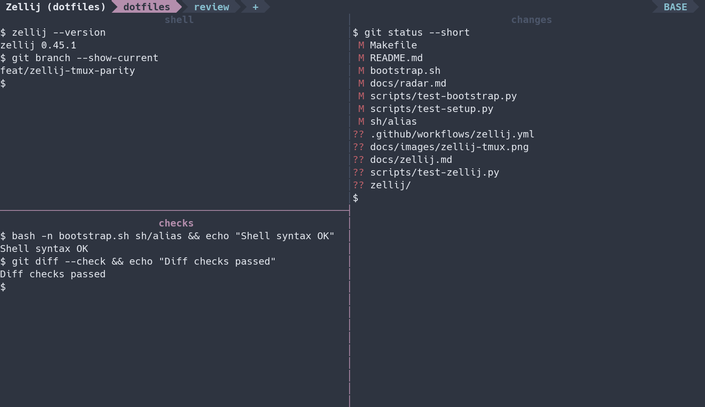

# Zellij with the tmux bindings

An opt-in Zellij configuration that follows [the existing tmux setup](../rc/tmux.conf): `Ctrl-f` prefix, Vim-style splits and navigation, a single top tab bar, and the Nord purple/cyan palette. The terminal normally stays in locked mode so application shortcuts pass through.



Terminal capture of this configuration running on Zellij 0.45.1.

## Start a session

Use the **pinned [lanej/zellij fork](https://github.com/lanej/zellij)** installed by this checkout, Python 3 for the configuration helpers, fzf, and Rust through rustup. The selected Zellij recipe defaults to the exact fork revision in [`scripts/install-zellij`](../scripts/install-zellij). The fork builds on upstream `main` at `bf517077`, which includes [OSC 7501 support](https://github.com/zellij-org/zellij/pull/5734) and the startup repair; it carries the remaining CLI completion and shutdown flush fixes with their native regression tests. Select the runtime explicitly through [configuration sets](../README.md#configuration-sets): `tools.zellij = true` enables the recipe; `zellij.source = "patched"` installs the fork, `"release"` installs upstream stable, and `"main"` builds pinned upstream main without the fork's fixes. The `terminal` and `workstation` bundles enable Zellij. The main and release choices omit the fork's fixes; the documented popup, query, and shutdown acceptance applies to the patched runtime. The native builds use Rust 1.95.0 without changing your default toolchain. Neovim is used to edit scrollback. Return the default pin to a stable release once it includes OSC support and these reliability fixes; broker delivery remains separate integration work.

The first native build takes longer than installing an upstream binary and needs a C/C++ compiler, Make, CMake, pkg-config, and OpenSSL development files. `bootstrap.sh` installs those build dependencies. On macOS, install Xcode command line tools and run `brew install cmake pkg-config openssl@3 fzf`. Cargo uses the fork's lockfile and caches compilation artifacts under `${XDG_CACHE_HOME:-$HOME/.cache}/dotfiles/zellij/target`. Each fork installation replaces the executable, including binaries left by the previous installer, while reusing the build cache. Cargo manages installation ownership and locking. The stock Homebrew or upstream 0.45.1 executable does not include these fixes.

This pinned build has an upstream startup race: an external CLI probe that disconnects before the first layout can interfere with [initial client registration](https://github.com/zellij-org/zellij/blob/bf517077c848d91f75091f66d1996cfeb84f4732/zellij-server/src/screen.rs#L6706-L6710). Wait for a new session's first shell prompt before querying it. The session detector follows that ordering; the upstream race remains present.

From the dotfiles checkout:

```sh
make zellij-runtime zellij
zellij attach --create main
```

`make config` shows the selected source before installation. `make zellij-runtime` installs that runtime, replacing the managed executable even when switching from a newer development version back to stable. `make zellij` installs configuration and helpers without installing a runtime or starting a session. Default `make` also installs this configuration. Setup records Zellij's native "never show again" choice for its configuration wizard, preserving other desktop settings, so the wizard does not block the managed keybindings on first launch. In a new shell, `zj main` is the short form of the attach-or-create command. Configuration and individual layouts are symlinked, preserving additional user layout files.

Restart existing session servers to use the fixes: replacing the executable does not replace a running server. Keep `$HOME/.local/bin` before package-manager directories in `PATH`. The fork reports the pinned upstream version, `0.46.0`, and includes its matching bundled plugins.

Use `Ctrl-f d` to detach and run the same attach command to return. Closing the terminal also detaches. Existing tmux configuration and shell startup are unchanged. [Firstmate can explicitly select Zellij](firstmate.md) through `FM_BACKEND=zellij` or its backend configuration; its default remains tmux.

## Familiar keys

Every key below follows **Ctrl-f**, unless stated otherwise. `Esc` cancels prefix mode. Most actions return immediately to locked mode.

| Key | Action |
| --- | --- |
| `f` | Send a literal Ctrl-f to the application |
| `Ctrl-f` | Fuzzy tab picker, with native bell tabs first and pane previews |
| `Ctrl-w` | Fuzzy picker for running sessions, with a tab-tree preview |
| `h`, `j`, `k`, `l` / arrows | Focus the adjacent pane |
| `Tab`, `o` | Focus the next pane |
| `;` | Focus the previously focused pane |
| `s`, `"` | Split below, inheriting the working directory |
| `v`, `%` | Split right, inheriting the working directory |
| `c` | New tab |
| `Ctrl-n`, `n` | Next tab |
| `Ctrl-p` | Last-focused tab |
| `r`, `,` | Rename the tab; Enter accepts and Esc restores the name |
| `1`–`9` | Select the tab at that one-based position; `0` also selects the first |
| `d` | Detach, keeping the session running |
| `x` | Close the focused pane |
| `z` | Toggle pane zoom |
| `Z` | Toggle zoom without the surrounding UI |
| `J`, `K` | Move the pane down/up |
| `<`, `>`, `+`, `-` | Resize toward left/right/up/down |
| `Ctrl-r` | Enter repeatable resize mode |
| `Space`, `Ctrl-o` | Next/previous columns, rows, stacked, or equalize layout |
| `P` | Open the shared persistent popup; the same key inside it hides that view |
| `F` | Show/hide the current tab's other floating panes |
| `Ctrl-q` | Confirm shutdown of the current Zellij session |
| `u`, `i` | Return to a containing Zellij session / enter the focused nested session |
| `!` | Move the focused pane to a new tab |
| `m` | Enter pane movement mode |
| `W` | Enter tab reorder mode |
| `C`, `w` | Open the native session manager for creating, switching, renaming, and restoring sessions |
| `e` | Open the pane's scrollback in Neovim |
| `[` | Enter scroll mode |
| `/` | Search the pane's scrollback |

`Ctrl-f Ctrl-f` follows the effective tmux binding: the later fuzzy-picker binding in `tmux.conf` overrides its earlier send-prefix binding. `Ctrl-f f` remains the way to send Ctrl-f through. Similarly, `Tab` keeps pane cycling rather than the earlier, overridden `Ctrl-i` layout binding.

**Resize mode:** `h/j/k/l` or arrows grow toward that edge; uppercase `H/J/K/L` shrink. `+`/`=` grows and `-` shrinks. **Move mode:** `h/j/k/l` or arrows move the pane, `Tab` cycles positions, and `[`/`]` moves it to the adjacent tab. **Tab reorder mode:** `h/l` or arrows reorder the tab. Enter or Esc exits these modes.

**Scroll mode:** `j/k` scroll, Ctrl-f/Ctrl-b page, Ctrl-d/Ctrl-u half-page, and `g/G` jump to the start/end. `/` starts a search; `n/N` find next/previous matches. `e` opens Neovim for arbitrary Vim selection. `y` copies an existing selection and returns to the prompt. `m` selects a command at the scroll position, and `c` copies the last command output when the application supplies OSC 133 shell markers. Esc or `q` returns to the bottom.

Clipboard copying uses OSC 52, including over SSH. Use the terminal's paste shortcut; `Ctrl-f p` is deliberately unbound because Zellij does not share tmux's paste buffers. The config does not replace it with a different action.

## Smart editor and shell navigation

Bare **Ctrl-h/j/k/l** move among Neovim splits first, then cross into the adjacent Zellij pane at an editor boundary. They work in normal and insert modes. The same keys at the configured **Zsh prompt** move back into Neovim or another pane, preserving a partially typed command. Run `make zellij zsh-config vim-config` and restart the shell/editor to install both sides.

Navigation stays in the current tab and does not leave a zoomed pane. Internal Neovim split movement continues while zoomed; use `Ctrl-f z` to restore the outer layout before crossing a pane boundary. Outside Zellij, Zsh keeps its normal Ctrl-h/backspace binding and Neovim keeps Navigator's existing tmux/WezTerm detection. The shared `zellij-context provider` helper identifies the nearest live multiplexer from process ancestry: Zellij inside tmux navigates its own panes, and tmux inside Zellij retains tmux navigation despite inherited outer environment variables.

The helper verifies one attached client's current source pane and tab, then rechecks the same client/pane immediately before moving focus. It rejects ambiguous multiple-client ownership; use `Ctrl-f h/j/k/l` with multiple clients attached. This fixes delayed navigation acting on another tab. Stable Zellij's CLI does not offer an atomic conditional focus action, so a small window between the final check and the action remains; it is not a strict server-side compare-and-focus guarantee. Missing helpers or failed ownership inspection leave pane crossing disabled rather than selecting an outer multiplexer from stale variables.

These are editor and prompt bindings: other foreground applications receive their own Ctrl-h/j/k/l shortcuts. Use `Ctrl-f h/j/k/l` from those applications or from other shells. Zellij remains in locked mode and no additional WASM plugin is installed.

## Equalize layout

Use **Ctrl-f Space** or **Ctrl-f Ctrl-o** to cycle to the **equalize** layout. It places one full-height pane in the left half and divides the right half into equal rows for the remaining panes. An indivisible column or row goes to one pane, so dimensions can differ by one cell; the pane title and separator still consume their normal space. This is a native layout change: pane positions can change, while the original pane IDs, focused terminal, shell processes, and scrollback survive. Percentage sizing continues to fit when the outer terminal changes size.

Start a new session with the updated `tmux` layout after `make zellij`; existing sessions retain their loaded swap layouts. The preset uses the same one-row top bar as columns, rows, and stacked layouts. Prefix `=` remains unbound: stable Zellij has no direct selection of an arbitrary named swap layout, and a helper that cycles while searching could change a custom tab before discovering that its layout is unavailable. The native cycle makes each layout change explicit.

**Golden-ratio sizing and exact three-cell resizing remain unavailable.** The tmux policy skips an ordinary `g` when the left pane is already at least 120 columns; forced `G` uses `floor(window width × 0.382)`, capped at 180 columns, with no 120-column floor. Stable Zellij's native resize action uses percentage steps and exposes no cell-count or timed-repeat option. Layout overrides match original launch metadata, which can create extra shells for existing panes that do not match; fixed-cell layouts also fail to adapt reliably when the outer window becomes narrower. Those overrides are not installed as a substitute. Prefix `g/G` remain unbound, and Ctrl-f Ctrl-r remains an explicit mode that ends with Enter or Esc, rather than tmux's timed repeat window.

Upstream implementation references: [native resize step](https://github.com/zellij-org/zellij/blob/v0.45.1/zellij-server/src/panes/tiled_panes/tiled_pane_grid.rs), [layout reuse and overrides](https://github.com/zellij-org/zellij/blob/v0.45.1/zellij-server/src/tab/layout_applier.rs), and [CLI actions](https://github.com/zellij-org/zellij/blob/v0.45.1/zellij-utils/src/cli.rs).

## Shared popup and session shutdown

**Ctrl-f P** opens a floating view of the dedicated `dotfiles-popup` session. Press **Ctrl-f P** again inside the popup to detach that view. Reopening it from another tab or another Zellij session on the same host and socket namespace returns to the same live shell, including its working directory and unexported variables. Each opening attaches a client to that session; it does not move a working pane between sessions. The outer configuration automatically focuses nested sessions so the popup receives its own prefix keys.

The popup has one shell, no inner tab bar or status plugin, and a 10,000-line live history limit. Its prefix keys are deliberately small: `P` or `d` hides the view, `f` sends Ctrl-f, `u/i` changes nested-session focus, and Esc, Enter, or Ctrl-c cancels prefix mode. Other main-session controls, including prefix `p` clipboard pasting and the shutdown shortcut, are unavailable inside this scratch session; the terminal's paste shortcut remains available. The popup stays alive after its view closes or its outer session shuts down. Running `exit` in the scratch shell ends it; its in-memory state does not survive server exit or reboot, and this dedicated session does not create resurrection snapshots. Keep `dotfiles-popup` reserved for this workflow. The previous floating-layer toggle is available as **Ctrl-f F**.

Automatic nesting focus applies to other compatible Zellij sessions too, including sessions reached over SSH. With these dotfiles in the guest, **Ctrl-f u** returns to its containing session without detaching; **Ctrl-f i** in the host enters its focused nested session again. A guest with another configuration uses its own `FocusHostSession` binding (upstream 0.45.1 defaults to Ctrl-o, then `]`). Detaching the guest also returns control to its host.

**Ctrl-f Ctrl-q** in the main configuration opens a confirmation naming the current session. Type `SHUTDOWN` to close its panes and disconnect its clients, or press Enter or Ctrl-c to cancel. The helper checks the owning server's Unix socket identity again before executing; development builds also check Zellij's session-ID index. It rejects a session that was renamed or replaced while confirmation was open. This ends one Zellij session and its server; other sessions, including a separately running popup, continue. **Ctrl-f d** still detaches the current client without shutting down its session.

**Selected-client detachment remains unsupported.** Prefix `D` is unbound. Stable 0.45.1 exposes a client list and current-client detach, but its CLI has no client-ID detach argument; the plugin API's disconnect-other-clients action affects every other client. Use `zellij action list-clients` to inspect the current session and detach from the intended client's terminal. A chooser must wait for a genuinely targeted API.

Implementation references: [native nesting options and focus behavior](https://github.com/zellij-org/zellij/blob/v0.45.1/zellij-integration-tests/tests/nested_session_handling_config.rs), [CLI session actions](https://github.com/zellij-org/zellij/blob/v0.45.1/zellij-utils/src/cli.rs), and [plugin client controls](https://github.com/zellij-org/zellij/blob/v0.45.1/zellij-tile/src/shim.rs).

## History and recovery

- **Live history:** at most 100,000 scrollback lines per pane.
- **Recovery history:** at most 10,000 saved scrollback lines per pane, with the viewport and session layout saved every 60 seconds.
- **Recovery behavior:** reattaching to an exited session reconstructs its layout and offers to rerun its commands. The native manager also lists these sessions. The fuzzy picker lists running sessions only.

These are line limits, **not a byte budget or a guarantee against memory exhaustion**. Recovery snapshots do not page live scrollback out of RAM. Detaching preserves live processes; restoring after server exit or reboot relaunches commands and does not restore their process memory. A crash can lose changes since the last snapshot.

## Differences that remain

| tmux behavior | This configuration |
| --- | --- |
| Agent-status glyphs/colors, cross-session attention counts, `Ctrl-f Ctrl-a` triage | The existing broker's tmux renderer is not ported. The picker can prioritize native bells but cannot infer agent state from terminal output. |
| Exact Claude conversation restoration via saved session IDs | Zellij's native command restoration is enabled; the custom `claude --resume` session-ID integration remains tmux-specific. |
| Rex OSC 7501 delivery through the patched tmux server | No replacement transport in this configuration. Upstream development features are not assumed to exist in stable 0.45.1. |
| Smart bare Ctrl-h/j/k/l across Neovim and tmux panes | Supported in Neovim normal/insert modes and at configured Zsh prompts. Other foreground applications retain their keys; use prefix navigation there. |
| Moving live windows/panes across sessions, including parking in `later` | Unsupported by Zellij. `H`, `S`, and `M` are not assigned a restart-based substitute. Native movement between tabs in the same session is available. |
| Vi visual/rectangle copy mode and shared paste buffers | Use Neovim scrollback editing, mouse selection, or supported whole-command selection; use terminal paste. |
| Zero-based windows | Number keys use Zellij's one-based tab positions. |
| Three-cell resizing and timed repeat bindings | Native Zellij resize steps; an explicit repeatable mode under prefix+Ctrl-r. |
| Golden-ratio helper (`g/G`) | Unbound; the width guard, exact ratio, and cap are not safely implemented with stable APIs. |
| Equalization (`=`) | The native equalize preset is available through layout cycling. Direct `=` selection and preserving each pane's position during equalization remain unsupported. |
| Dedicated shared `popup` session | `P` attaches to the live `dotfiles-popup` scratch session across tabs and sessions on the same host; `F` toggles other floating panes. |
| Custom clock, battery, host, and agent status segments | One bundled top tab bar, with no bottom status bar or additional plugin download. |
| Kill-server confirmation | `Ctrl-q` confirms shutdown of the current session's server. It does not shut down every Zellij session. |
| Client-detach chooser | `D` remains unbound because stable APIs cannot detach one selected client. Ordinary `d` detaches the current client. |

Reference: [Zellij 0.45.1](https://github.com/zellij-org/zellij/releases/tag/v0.45.1), [session resurrection](https://zellij.dev/documentation/session-resurrection.html), and [the upstream cross-session movement limitation](https://github.com/zellij-org/zellij/issues/5118).

## Check a change

```sh
zellij setup --check
make test-zellij
make test-zellij-navigation
make test-zellij-layout
make test-zellij-sessions
```

The workflow check installs into a temporary home, sends real prefix keys to Zellij in a pseudo-terminal, exercises the actual fzf pickers, and verifies that detach/reattach keeps the panes and a shell's in-memory state. The navigation check uses installed Zsh bindings, real Neovim, and the pinned Navigator plugin to exercise editor boundaries in both directions, insert mode, zoom, application key passthrough, both multiplexer nesting directions, and a tab change during a delayed navigation query. It requires Neovim 0.12+, Zsh, tmux, git, and access to the public plugin repository. Both checks require local Unix sockets and PTYs and terminate only their own named sessions. Linux and macOS CI run them against the same pinned fork revision as bootstrap. Native Rust regressions live with the fixes in the fork. These checks do not establish performance under production agent output or clipboard behavior in a particular terminal emulator.

The layout check cycles through the installed layout control with an explicit-command shell, observes equalize dimensions before and after a terminal resize, and checks stable pane IDs, focus, shell PIDs, unexported shell variables, and scrollback.

The session checks observe host/guest focus control and the same popup shell PID, cwd, and unexported state across hiding, another tab, and another outer session. They exercise shutdown cancellation, reject an old confirmation after renaming its session and recreating the original name, and verify that other sessions and the original popup shell survive a valid targeted shutdown. All servers use a private temporary socket directory.
