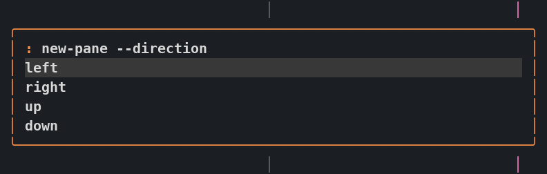

Press **Ctrl-f :** to open a slim floating command line. Type a Zellij action without the `zellij action` prefix. Up to five suggestions appear below the input, and the popup shrinks as matches narrow. Use the arrow keys to select a suggestion and **Tab** to complete it. **Enter** runs the command you entered; selecting a suggestion never runs it. **Esc** or clicking outside cancels; an empty command closes it too.

The command line is centered horizontally near the upper part of the terminal and stays in place as suggestions change. It is separate from the [shared popup](shared-popup.mdx) and leaves hidden floating panes hidden.



## Examples

```sh
rename-tab "work notes"
new-pane --direction right
new-pane --floating -- htop
move-focus left
resize increase right
```

## Completion and editing

Suggestions include actions and descriptions, native flags and their accepted values, and live targets. For example, `new-pane --dir` completes to `new-pane --direction`, then offers directions. `rename-tab ` offers the current name for editing. `go-to-tab-name `, `focus-pane-id `, and `switch-session ` suggest live tabs, panes, and running sessions. Names containing spaces are quoted automatically.

**Ctrl-u** clears before the cursor, **Ctrl-k** clears after it, and **Ctrl-w** deletes the previous word. Pasting edits the line without submitting it. Parse errors leave the command available to correct; **Ctrl-d** opens the full error, and **Esc** returns to editing.

## Help and history

Type `help` for a searchable action picker. Selecting an action fills the input so you can edit it before running it. Add `--help` to an action to view its native documentation. **Enter** or **Esc** returns to the command.

Type `history` or press **Ctrl-r** to search this client's recent commands. The selected command returns to the input for review before it runs. **Ctrl-p** and **Ctrl-n** recall older and newer commands, restoring your unsubmitted draft when you return to the end. **Up** from an empty input also recalls history. The last 32 distinct commands stay in memory until the plugin or session restarts.

## Find a live target

Run `list-panes`, `list-tabs`, or `list-sessions` to open a searchable table. Type to filter, use the arrows to select a row, and press **Enter** to jump to it. **Esc** returns to your original command. The tables refresh as live state changes. Help, history, and target tables expand only while open; returning to command entry restores the compact view.

Displayed tab positions are zero-based, matching the bar. The native `go-to-tab` command still takes a one-based index, shown in its completion details. Use `go-to-tab-by-id` for a stable tab ID.

## Scope and setup

This prompt runs Zellij actions, not shell commands. Quotes group arguments, but `$HOME`, pipes, wildcards, and command substitution are not expanded. To start a program, use an action such as `new-pane -- htop`.

The three target-list commands take no flags. Use a normal terminal for JSON output, layout-file loading, external plugin installation, and CLI-only pane-relative or explicit-ID action variants. The native action API does not return all runtime errors, so submission alone does not confirm that an action succeeded.

The palette needs the managed modern configuration and matching pinned runtime. After updating the checkout, install the runtime with `bash scripts/install-zellij`, rebuild with `make zellij-command-prompt`, apply `make zellij`, and save your work before restarting the session. Existing installations may ask for expanded plugin permissions. The matching runtime keeps pasted text in the requesting client's popup and preserves Unicode input.
