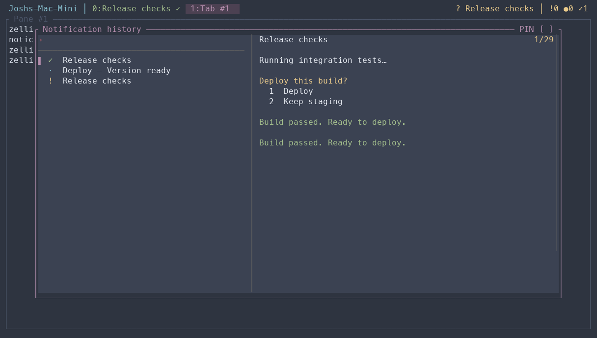

Background questions, failures, and completions appear briefly in the top bar as colored notices. They leave keyboard focus in your application. Progress stays quiet, and a success does not replace a question or failure that is still being shown.

## Open history

Press **Ctrl-f B**. Type to search titles or messages, and move through the recorded events. The selected entry previews its source pane's **current contents**, including terminal colors. It is not a saved screenshot of the event.

**Enter** visits a source that is still available. **Esc** closes history. **Ctrl-/** hides or restores the preview, which moves below the list in narrow windows. A closed or replaced source shows **Pane unavailable**.



Colored glyphs distinguish information, completed tasks, requests, and failures. Identifiers and generated labels stay hidden. Dates appear only across different days; identical times are omitted.

## Current attention or past events?

**Ctrl-f b** opens the current [inbox](attention.mdx). **Ctrl-f B** opens recorded history, including events whose attention has already cleared. History keeps up to 500 events. Events while every view of their source session is detached may be missing, even though the inbox still tracks current attention.

## Send a notification

From a script running inside Zellij:

```sh
zellij-notify send --level warn --title Tests 'Integration tests need attention'
zellij-notify send --level success --title Build 'Release build passed'
```

Available levels are `info`, `success`, `warn`, and `error`. Script messages appear in the bar and history; they do not create an unresolved inbox item. This feature needs the modern configuration.
