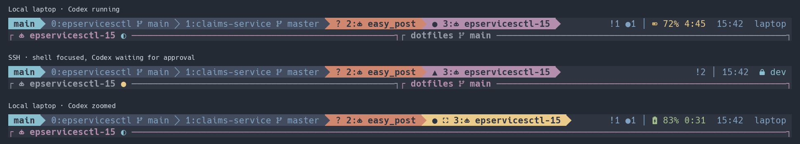

The session name is at the left of the top bar. The selected tab is bold on purple. Zooming it changes the background to gold and puts an expand glyph beside its number. An orange tab needs input, and a red tab has failed. Each tab keeps its state glyph when you select it.

## Find a tab

Tab positions start at **0**. **Ctrl-f 0** selects the first tab, **Ctrl-f 1** the second, and so on through **Ctrl-f 9**. Use these positions even when a program's title contains another number.

An unnamed tab adopts the oldest tiled terminal pane with a meaningful title. If another pane uses the same title, either pane can keep it alive. Switching focus, running a command, or changing directory leaves the tab name in place. When the last pane that supplied the name closes or leaves the tab, the oldest remaining titled pane supplies the next name. Shell pane titles continue to show the current directory and branch, such as `dotfiles  main`.

To give a tab a lasting name, press **Ctrl-f r**, type a name such as `review`, and press **Enter**. That name stays when you switch programs. **Esc** or **Ctrl-c** cancels the rename.

After restoring a session, a tab whose saved name uniquely matches a recorded automatic title resumes naming from its live panes. Other names stay manual. Older title records cannot prove that ownership; to restore automatic naming for such a tab, find its `TAB_ID` with `zellij action list-tabs`, then rename it to `Tab #N`, where N is that ID plus one.

The focused pane has a purple title and border. Other visible panes keep their titles and borders in gray when you switch focus. Codex pane titles show the agent icon and project, such as `󰚩 epservicesctl-15`. Its activity marker can change while the name stays in place. In the tab bar, older Codex and Claude titles also collapse to the icon and project.

Use the [tab picker](tab-picker.mdx) when a title is clipped or you have more tabs than fit in the bar.

## Read the bar

| Mark | Meaning |
| --- | --- |
| `?` | A question needs an answer |
| `▲` | A permission request needs approval |
| `!` | Another request or bell needs attention |
| `×` | A task failed |
| `✓` | A task finished |
| `●` | A task is working |
| `·` | A pane has new output |
| `󰊓` | The tab contains a zoomed pane. **Ctrl-f z** restores the split. |

The right side shows nonzero counts, battery, time, and the short hostname. An SSH attachment adds a lock beside the hostname for that client. Battery percentage and the available time estimate come from the machine running Zellij. Charging is green. Discharging turns orange below 20% and red below 10%. A full or idle battery takes no space. As the row fills, the estimate and clock give way before the compact battery and SSH host. The selected tab gets space for its project name before neighboring tabs share the rest. See [attention and triage](attention.mdx) for moving to work that needs you.

Pressing **Ctrl-f** temporarily highlights the bar while it waits for the next key. **Esc** cancels. Resize, search, and rename modes have their own labels, so you can see when ordinary keys have a different meaning.
