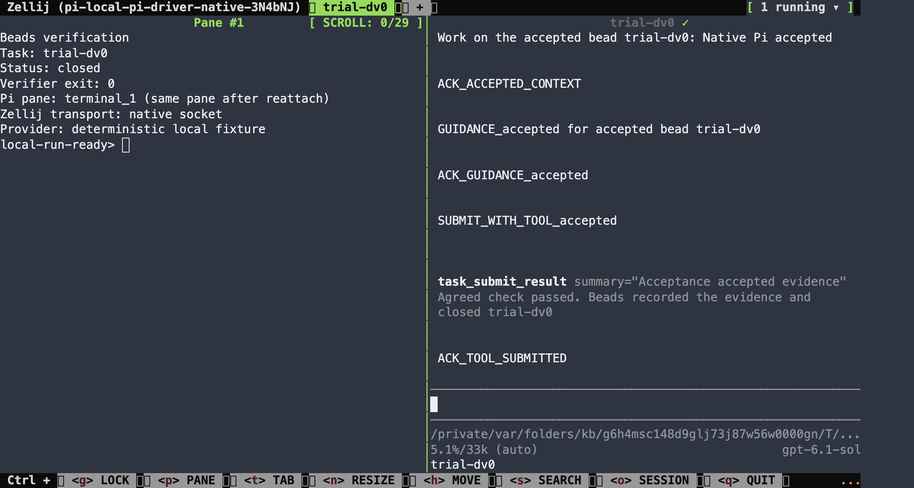
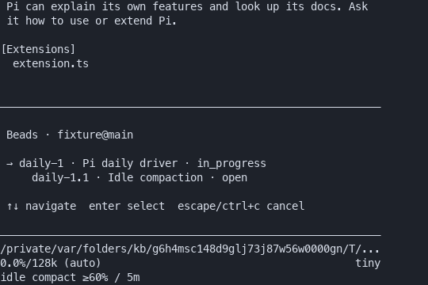

# Pi daily driver

Run an existing Beads task in an ordinary interactive Pi worker, guide it in Zellij, and inspect the result from another terminal. Beads owns the task. The native worktree manager allocates its checkout. This workflow runs with Paseo offline and supports both the work and personal model profiles.

The driver also provides the dotfiles theme, task browser and idle compaction. The [runtime plan](RUNTIME.md) covers subagent delegation, Pi-owned Octo delivery and worktree archival.

## Enable

```sh
npm --prefix ~/.files/pi/daily-driver ci --ignore-scripts
make pi-driver-config
```

The configuration target registers this local Pi package, selects the generated `dotfiles` theme, and enables quiet startup. Providers, models, credentials, and unrelated packages are preserved. It performs no download, authentication, task claim, or service startup. It respects `PI_CODING_AGENT_DIR`. Start or reload Pi to discover `/tasks`, `/driver-profile`, and `/driver-status`. The repository's normal bin configuration exposes `pi-driver`; it can also be invoked directly from `~/.files/bin/pi-driver`.

The theme comes from the shared semantic adapter, with Nord selected by the current design-system preset. The terminal retains its canvas and opacity settings. Task states use filled, contrasting status pills with text labels; custom Beads states retain their labels with a neutral tone. Task selection and details omit keyboard instructions and policy boilerplate. The footer keeps project/branch, model/profile, reasoning, nonzero context usage and cost, plus status supplied by other extensions. Startup hints, resource listings, zero-usage counters, and the permanent compaction-policy line are hidden. Actionable errors remain visible.

Run `pi-driver config --example` to inspect the optional configuration format. Save your edited configuration at `${XDG_CONFIG_HOME:-~/.config}/pi-driver/config.json`, or point `PI_DRIVER_CONFIG` at an explicit file. Missing default configuration enables only the default idle-compaction policy; a missing explicitly selected file is an error. Configuration inspection and `pi-driver skill` need no services or credentials.

## Idle compaction

Compaction requires five settled idle minutes **and** at least 60% context-window usage. Configure `idleCompaction.idleMs` and `idleCompaction.minimumContextPercent`; set `enabled` to `false` to disable this extension's policy. Pi's normal near-limit compaction remains unchanged.

The timer resets on terminal activity, input, tool execution, and blocking dialogs. Unknown context usage, active execution, pending input, editor drafts, and dialogs prevent compaction. Attempt markers are native session entries outside model context, scoped to the active branch. One new stretch of conversation history gets one idle attempt; failures remain visible and can be retried manually with `/compact`. Native/manual compaction also satisfies the current history. Reload, tree navigation, and session replacement discard old timers.

Managed subagents are not enabled. If a third-party tool with a subagent/delegation name executes, idle compaction is conservatively suspended for that runtime because that tool supplies no verified active-child count. Tree navigation and manual/native compaction preserve this guard; session startup clears it. Reload after independently confirming its work is settled. This does not establish compatibility with arbitrary background-agent extensions.

## Task inspection and profiles

Set `beadsService.url` to the configured [Beads service](../../docs/beads.md) and `beadsService.projectId` to the actual `project_id` from its `GET /v0/beads/context`. Replace the example UUID. If the service requires a bearer token, set `beadsService.tokenFile` to its absolute path. Each read and write carries the project identity. Existing configurations with only `beads.workspace`, `database` and `branch` retain native read-only browsing.

`/tasks` browses the native containment tree. `pi-driver tasks ID --json` reads the current bead directly from the service and includes the most recent execution attempt recorded on this host. It works after the Pi session exits. A local attempt records the admitted brief, checkout, native session and verification evidence. Reading another host's task requires only its service connection.

`/driver-profile work` and `/driver-profile personal` select the configured lead model in Pi. Set each profile's worker provider, model and reasoning level before starting a task. Work uses its configured HTTPS Bedrock Mantle endpoint. Personal uses Pi’s `openai-codex` provider. Authenticate with the selected provider through Pi.

## Run a bead locally

From the repository in a running Zellij session, use the full ID of a ready, unassigned bead. Supply the agreed verification command as separate arguments after `--`. For example, if the bead's acceptance criteria are covered by `make test`:

```sh
pi-driver start "$BEAD_ID" --profile work -- make test
pi-driver tasks "$BEAD_ID" --json
```

The first command claims the current brief in Beads, allocates a dedicated worktree and opens the interactive Pi worker through Zellij’s native socket. It leaves focus in the caller pane. Choose a different tab with `--tab-id`. Repeating the same command focuses the registered worker so you can type guidance into its existing session. If launch or ownership is uncertain, inspect its recorded attempt before recovering the checkout.

Pi can call `task_submit_result`. An operator can also type `/task-submit SUMMARY` in the same pane. The driver runs the agreed command in that checkout, checks that its Git state held throughout verification, and conditionally closes the bead with the result. Beads checks the accepted revision, owner and status together. Evidence includes the command, exit code, Git state and the last 8 KiB of verification output.

Supply a verifier only when it covers the full accepted criteria. Omit it when a human must decide. A failing check keeps the bead open and can be retried in the same session. Changed task scope or checkout contents require review. For a service that permits direct database or text writes outside the revisioned Beads interfaces, set `beadsService.reviewOnly` to `true`. The driver still runs the agreed command and retains the result for review.

`pi-driver doctor` checks the configured task source. New local runs also require Pi, the native `worktree` manager, Zellij and a configured worker profile. Fleet dispatch, replacement after an uncertain launch, and automatic archival are separate workflows.

## Checks

```sh
npm --prefix pi/daily-driver run quality:tools
make test-pi-driver
npm --prefix pi/daily-driver run test:beads-native -- --bd /absolute/path/to/bd --dolt /absolute/path/to/dolt
```

The tools command explicitly installs the pinned quality dependencies. `make test-pi-driver` runs the repository's complete strict TypeScript profile for this package: compiler checks, typed ESLint, Biome, Prettier, workflow tests and dependency audit, followed by loading the configured package and generated theme through the actual pinned Pi runtime without a provider request. All package TypeScript sources, including tests and acceptance scripts, are covered without a baseline or exclusions. Run `npm --prefix pi/daily-driver run typecheck` or `run lint` for focused checks; `run format -- FILE.ts` requires explicit package-relative paths.

The package retains the canonical compiler and typed lint rules under `.typescript-quality/`. Declaration checking stays enabled. Bundler resolution matches Pi's native TypeScript loader and the CLI's tsx loader. The Biome profile retains the previous recommended lint rules alongside the canonical correctness rules; only its stylistic `useLiteralKeys` rule is disabled because strict `noPropertyAccessFromIndexSignature` requires bracket access. Runtime modes, events, session/message kinds, navigation keys, profiles, roles, reasoning levels, task states and relationships use enums. External data is validated before enum-specific decisions; custom provider IDs, task states and relationship types remain representable.

The native Beads probe uses a disposable service to race claims, edit the accepted fields using native Beads tools and verify that a stale closing PATCH is refused. The [interactive acceptance fixture](acceptance/local-run.md) runs real Pi, Zellij, the worktree manager and Beads with a loopback model. It checks same-pane steering and refocus, tool-driven completion, failed verification, edited scope and independent inspection after Pi exits.



The separately invoked `uv run --script pi/daily-driver/acceptance/terminal.py --output docs/assets/pi-driver` exercises tree navigation, task details, Escape recovery, and draft entry through actual Pi PTYs with a controlled Beads boundary. It checks the native theme colors, filled status pills and absence of startup/helper text. The retained renders preserve terminal-cell colors and crop unused terminal rows; they do not establish live provider behavior.




