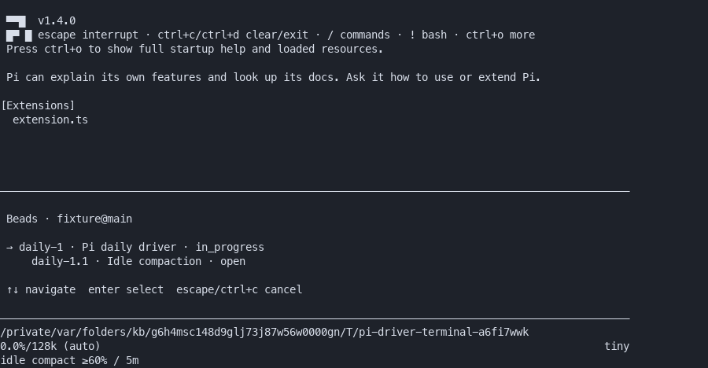

# Pi daily-driver foundation

This package extends Pi 1.4.0 with idle compaction, explicit work/personal model selection, and a read-only Beads task browser. It is not a complete daily-driver replacement: managed task launch, delegation, worktree provisioning, Octo delivery, task acceptance, and automatic archival are disabled by the Beads execution-authority gate below. Existing standalone Pi and Paseo workflows remain separate.

## Enable

```sh
npm --prefix ~/.files/pi/daily-driver ci --ignore-scripts
make pi-driver-config
```

The configuration target registers this local Pi package while preserving providers, models, credentials, and unrelated packages. It performs no download, authentication, task claim, or service startup. It respects `PI_CODING_AGENT_DIR`. Start or reload Pi to discover `/tasks`, `/driver-profile`, and `/driver-status`. The repository's normal bin configuration exposes `pi-driver`; it can also be invoked directly from `~/.files/bin/pi-driver`.

Run `pi-driver config --example` to inspect the optional configuration format. Save your edited configuration at `${XDG_CONFIG_HOME:-~/.config}/pi-driver/config.json`, or point `PI_DRIVER_CONFIG` at an explicit file. Missing default configuration enables only the default idle-compaction policy; a missing explicitly selected file is an error. Configuration inspection and `pi-driver skill` need no services or credentials.

## Idle compaction

Compaction requires five settled idle minutes **and** at least 60% context-window usage. Configure `idleCompaction.idleMs` and `idleCompaction.minimumContextPercent`; set `enabled` to `false` to disable this extension's policy. Pi's normal near-limit compaction remains unchanged.

The timer resets on terminal activity, input, tool execution, and blocking dialogs. Unknown context usage, active execution, pending input, editor drafts, and dialogs prevent compaction. Attempt markers are native session entries outside model context, scoped to the active branch. One new stretch of conversation history gets one idle attempt; failures remain visible and can be retried manually with `/compact`. Native/manual compaction also satisfies the current history. Reload, tree navigation, and session replacement discard old timers.

Managed subagents are not enabled. If a third-party tool with a subagent/delegation name executes, idle compaction is conservatively suspended for that runtime because that tool supplies no verified active-child count. Tree navigation and manual/native compaction preserve this guard; session startup clears it. Reload after independently confirming its work is settled. This does not establish compatibility with arbitrary background-agent extensions.

## Task inspection and profiles

Configure an absolute `beads.workspace`, expected `database`, and Dolt `branch`. The reader requires server-mode metadata and checks the actual branch through native `bd --readonly --sandbox` operations. It never initializes a database or falls back to another workspace. Ambient `BEADS_` variables and `BD_` overrides are excluded. Task trees use native parent-child edges; blockers remain separate. Results are capped at 1000 tasks and visibly marked when potentially truncated. `/tasks ID` or `pi-driver tasks ID` reads task details; observed descriptions are not accepted execution scope. Cached ownership decisions are not used.

`/driver-profile work` and `/driver-profile personal` explicitly select the configured lead model after validating that all four role models exist in Pi's registry. The work profile requires explicit HTTPS Bedrock Mantle model endpoints; personal uses Pi's `openai-codex` subscription provider. Authenticate through Pi's own flow. Model identifiers in `config --example` are selections to validate against your available catalog, not a claim of account access. No credentials are copied and there is no cross-profile fallback. Worker/reviewer/explorer settings are retained configuration, not active delegation.

## Dispatch gate

The [task contract](https://github.com/lanej/dotfiles/issues/353) requires a stale accepted scope/control revision to prevent authoritative transitions. In an isolated Beads 1.3.4 / Dolt 2.7.4 server fixture, two callers raced for one task: one won, a stale owner failed with exit 13, and repeating the winning actor's claim succeeded. After another actor edited the description, the previous owner could still change task status using `--if-assignee` and `--if-status`. The same guards allowed closing a changed task in the initial probe. These primitives do not fence accepted brief revisions.

`pi-driver doctor` reports this blocker and exits nonzero. `start` and `resume` reject before calling Beads, allocating a worktree, or launching Pi. There is no configuration switch that bypasses the gate. The [upstream development source](https://github.com/gastownhall/beads/blob/main/cmd/bd/assign.go) contains revision-guard work, but its presence does not establish a compatible released deployment or authorize migration of the existing trial database. Re-evaluate the native contract before implementing managed dispatch and its dependent lifecycle.

## Checks

```sh
make test-pi-driver
npm --prefix pi/daily-driver run test:beads-native -- --bd /absolute/path/to/bd --dolt /absolute/path/to/dolt
```

The first command checks local formatting/types, controlled workflow behavior, and discovery through the actual pinned Pi runtime without a provider request. The native Beads probe creates and removes its own database and processes, verifies real task parsing and claim behavior, and exits **2** with `dispatchReady: false` for the evaluated scope-fencing gap. It does not start, stop, migrate, or inspect the trial database's tasks. These checks do not establish authenticated model inference, a real GitHub round trip, Linux runtime acceptance, or the blocked archive lifecycle.

The separately invoked `uv run --script pi/daily-driver/acceptance/terminal.py --output docs/assets/pi-driver` exercises tree navigation, task details, Escape recovery, and draft entry through actual Pi PTYs with a controlled Beads boundary. These retained renders show the native interface at both checked widths; they do not establish live provider behavior.



