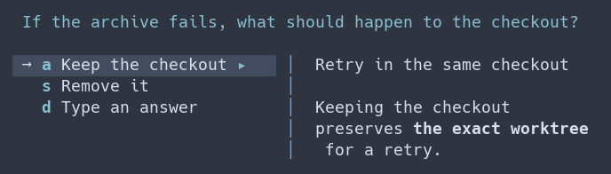
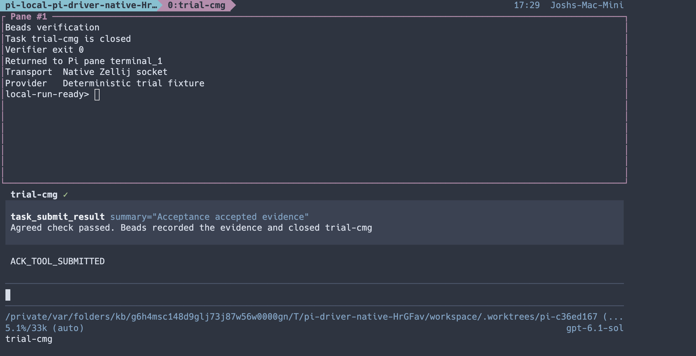
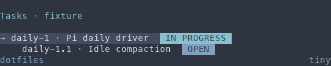
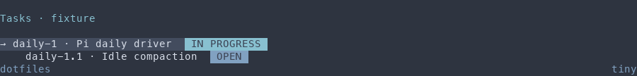
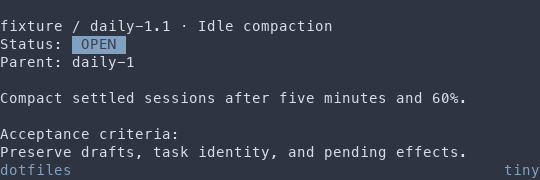

# Pi daily driver

Run an existing Beads task in an interactive Pi lead session, guide it in Zellij, and inspect the result from another terminal. Beads owns the task. The native worktree manager allocates its checkout. This workflow runs with Paseo offline and supports both the work and personal model profiles.

The driver also provides the dotfiles theme, task browser and idle compaction. The [runtime plan](RUNTIME.md) covers subagent delegation, Pi-owned Octo delivery and worktree archival.

## Enable

```sh
bun install --frozen-lockfile --ignore-scripts
bun run install:local
```

Installation builds a versioned bundle under `~/.local/share/pi-driver/releases`, exposes `~/.local/bin/pi-driver`, and registers that bundle with Pi. It includes the pinned Bun runtime, Pi host, extension sources, and resources. Providers, models, credentials, unrelated packages, and an existing theme choice are preserved. `PI_CODING_AGENT_DIR` selects an alternate Pi directory; `PI_DRIVER_PREFIX` selects an alternate installation prefix. Reload or relaunch Pi to discover `/cd`, `/tasks`, `/driver-profile`, and `/driver-status`. Existing sessions keep running.

For development, `bun run configure` registers this source package without installing it. `bun run build:aot` builds the compiled CLI; `scripts/pi-driver` uses it when available. Set `PI_DRIVER_USE_SOURCE=1` to select source execution. `scripts/pi` starts the pinned native Pi host explicitly through Bun. Managed hosts and delegated children use Bun; Node/npm are not required by this package. Python is needed for installation/configuration helpers. The integration tools below are optional; installation does not provision them.

The project-owned updater adapter is `scripts/lifecycle.mjs`. Once the separate checkout is registered with the workstation's project updater, use `project-update pull pi-driver`, `project-update build pi-driver`, and `project-update restart pi-driver`, or `project-update update pi-driver` for the sequence. Restart returns 3 with a manual reload/relaunch reminder; it does not terminate sessions. Status reports installed source identity separately from the unknown running revision. Build stages the selected checkout without pulling. Previous bundles remain available.

Register the chosen checkout using the existing updater registry format (replace the path with the selected destination):

```toml
[projects.pi-driver]
path = "~/src/CHOSEN-CHECKOUT"
command = ["bun", "scripts/lifecycle.mjs"]
```

Export standalone source with `python3 scripts/export.py /path/to/empty-destination`. Repository creation and updater registration await the destination choice. See [provenance and cutover](EXTRACTION.md).

The theme comes from a bundled snapshot of the shared semantic adapter, with Nord selected by the current design-system preset. The terminal retains its canvas and opacity settings. The task tree opens as a right-side overlay with colored status glyphs. Enter opens task details with the state written out. Right focuses a task’s live managed Pi pane in the same Zellij session when the action is shown. Task selection and details omit keyboard instructions and policy boilerplate. The footer shows the current directory using [shortpath](https://github.com/lanej/dotfiles/blob/master/tools/shortpath/README.md) when it is on PATH. Colored glyphs mark the lead mode and reasoning level alongside the bead ID and model. The same row fits Git changes, the Octo-tracked PR, context usage, and estimated session cost as space allows. GPT model IDs show a provider glyph, version, and variant glyph for Sol, Luna, Terra, and Astra. Secondary fields collapse as the pane narrows, and other extensions retain their status lines. Startup hints, resource listings, zero-usage counters, and the permanent compaction-policy line are hidden. Bash tool cards highlight shell syntax in command lines. Code from Pi’s grep tool and supported `rg` and `sed` shell tool calls uses the active syntax theme. Pi’s output folding and truncation remain available. Actionable errors remain visible.

Run `pi-driver config --example` to inspect the optional configuration format. Save your edited configuration at `${XDG_CONFIG_HOME:-~/.config}/pi-driver/config.json`, or point `PI_DRIVER_CONFIG` at an explicit file. Missing default configuration enables only the default idle-compaction policy; a missing explicitly selected file is an error. Configuration inspection and `pi-driver skill` need no services or credentials.

## Working directory

Use `/cd /path/to/project` to change directories while continuing the current conversation. Relative paths, `~`, and paths containing spaces are supported; `/cd` alone opens your home directory. Conversation history, compaction summaries, the session tree and selected branch carry over, along with the model and thinking level. An explicitly selected driver profile is revalidated for the destination before delegation is re-enabled. Pi rebuilds its tools, project instructions, settings and resources for the destination, including its normal project trust checks. A directory-change message records the new location in the conversation. Pi saves the continuation under the destination with a link to the original session; the original file remains intact. Switching requires settled conversation and delegated work; managed Beads sessions stay in their assigned checkout. `/cd` is unavailable with `--no-session`, so switching never saves a deliberately private conversation.

## Optional integrations

Zellij, worktree manager, Octo, and Beads are optional. With no driver configuration, the extension still supplies directory switching, idle compaction, search rendering, and archive browsing; the CLI can inspect configuration and report integration status. Installation does not start or require these services.

Set `integrations.zellij.enabled`, `integrations.worktrees.enabled`, or `integrations.octo.enabled` to opt in. Each accepts an `executable` name or absolute path. These integrations default to disabled and become available only when the configured executable is present. Configure Beads separately with `beadsService` or a read-only `beads` source. A configured service must be reachable to perform its operations. Missing or disabled integrations fail only the commands that need them, before task claims or checkout allocation.

| Capability | Integrations needed |
| --- | --- |
| Task inspection | Configured Beads source |
| Managed launch, focus, resume | Beads service, Zellij, worktree manager; launch/focus also need a live Zellij session |
| Explorer/Reviewer delegation | Explicit delegation/profile configuration and worktree manager |
| Publish, PR feedback, merge | Bound task/Beads workflow and Octo |
| Finalize managed checkout | Bound task/Beads workflow, Octo, worktree manager |

`pi-driver doctor` and `/driver-status` report enabled, present, and available states. Doctor also checks the package resources needed by the compiled CLI and native host. Doctor succeeds with no optional integrations configured; enabled integrations that are missing or configured Beads sources that fail verification make it fail. The full configuration example enables the managed workflow integrations; remove or disable the ones you do not use.

## Idle compaction

Compaction requires five settled idle minutes **and** at least 60% context-window usage. Configure `idleCompaction.idleMs` and `idleCompaction.minimumContextPercent`; set `enabled` to `false` to disable this extension's policy. Pi's normal near-limit compaction remains unchanged.

The timer resets on terminal activity, input, tool execution, and blocking dialogs. Unknown context usage, active execution, pending input, editor drafts, and dialogs prevent compaction. Attempt markers are native session entries outside model context, scoped to the active branch. One new stretch of conversation history gets one idle attempt; failures remain visible and can be retried manually with `/compact`. Native/manual compaction also satisfies the current history. Reload, tree navigation, and session replacement discard old timers.

Managed Explorer and Reviewer children suspend idle compaction while their work remains active or uncertain. If a third-party tool with a subagent/delegation name executes, idle compaction is conservatively suspended for that runtime because that tool supplies no verified active-child count. Tree navigation and manual/native compaction preserve this guard; session startup clears it. Reload after independently confirming its work is settled. This does not establish compatibility with arbitrary background-agent extensions.

## Task inspection and profiles

Set `beadsService.url` to the configured [Beads service](https://github.com/lanej/dotfiles/blob/master/docs/beads.md) and `beadsService.projectId` to the actual `project_id` from its `GET /v0/beads/context`. Replace the example UUID. If the service requires a bearer token, set `beadsService.tokenFile` to its absolute path. Each read and write carries the project identity. Existing configurations with only `beads.workspace`, `database` and `branch` retain native read-only browsing.

`/tasks` browses the native containment tree. `pi-driver tasks ID --json` reads the current bead directly from the service and includes the most recent execution attempt recorded on this host. It works after the Pi session exits. A local attempt records the admitted brief, checkout, native session and verification evidence. Reading another host's task requires only its service connection.

`/driver-profile work` and `/driver-profile personal` select the configured lead model in Pi. Set each profile's worker provider, model and reasoning level before starting a task. Work uses its configured HTTPS Bedrock Mantle endpoint. Personal uses Pi’s `openai-codex` provider. Authenticate with the selected provider through Pi. The example uses Sol at high reasoning for the lead, medium for Worker and Reviewer, and low for Explorer. You can select a smaller role model when it is available in that provider’s Pi catalog.

## Run a bead locally

From the repository in a running Zellij session, use the full ID of a ready, unassigned bead. Supply the agreed verification command as separate arguments after `--`. For example, if the bead's acceptance criteria are covered by `make test`:

```sh
pi-driver start "$BEAD_ID" --profile work -- make test
pi-driver tasks "$BEAD_ID" --json
```

The first command validates the selected lead profile, claims the current brief in Beads, allocates a dedicated worktree and opens the interactive Pi lead through Zellij’s native socket. It leaves focus in the caller pane. Choose a different tab with `--tab-id`. Repeating the same command focuses the registered worker so you can type guidance into its existing session. If launch or ownership is uncertain, inspect its recorded attempt before recovering the checkout.

The lead starts in read-only planning mode. Use `/socrates` to work through scope and evidence using the shared Socrates procedure. The lead saves consequential questions before opening a native Pi dialog. Escape leaves a question open, and `/socrates` resumes it. A complete brief can go straight to specification review. Use `/spec-freeze` to review and freeze the specification before asking Pi for its implementation plan. Use `/plan` to inspect the task graph and `/plan-approve` to review its dependency waves and authorize implementation. The approval creates child beads and their containment and blocker edges in one revision-guarded batch. The graph and review patterns are adapted from [Smart Plan](https://github.com/jnardiello/pi-smart-plan/tree/3e51e33acd63a7743391e21598042438746aafa0). Use `/plan-refresh` to read a changed brief and reopen the specification. Use `/diff` to review working-tree changes inside Pi.

Use `j` and `k` to move through choices, `;` and a letter hint to jump, `l` to inspect details, and `h` to return. The Markdown explanation beside the list follows keyboard focus. Evidence can include a source file and line, a URL, or an observation such as command output. Source and URL references use OSC 8. A `▸` beside a choice indicates a longer explanation or evidence links. Press `Enter` to select the focused choice. Escape backs out of hints or details before it dismisses the question.



Run `pi-driver resume "$BEAD_ID"` in Zellij after Pi exits. The driver revalidates the Beads claim and opens the original transcript in the same managed checkout.

Pi can call `task_submit_result`. An operator can also type `/task-submit SUMMARY` in the same pane. The driver runs the agreed command in that checkout and checks that its Git state held throughout verification. A lead saves passing evidence and retains the open Beads task while waiting for delivery. The legacy direct `start --worker` flow can record local verification and close the bead. Beads checks the accepted revision, owner and status together. Evidence includes the command, exit code, Git state and the last 8 KiB of verification output.

Supply a verifier only when it covers the full accepted criteria. Omit it when a human must decide. A failing check keeps the bead open and can be retried in the same session. Changed task scope or checkout contents require review. For a service that permits direct database or text writes outside the revisioned Beads interfaces, set `beadsService.reviewOnly` to `true`. The driver still runs the agreed command and retains the result for review.

`pi-driver doctor` checks the configured task source. New local runs also require Pi, the native `worktree` manager, Zellij and a configured worker profile. Fleet dispatch and replacement after an uncertain launch are separate workflows.

## Deliver through Octo

The local Octo service and CLI must support Pi tracking. Push the reviewed branch head to GitHub, verify its clean commit in the lead, then publish its reviewed PR draft.

```sh
pi-driver publish "$BEAD_ID" --title "$TITLE" --body-file "$BODY" --base main
```

Reissue the same request to reconcile its stored publication receipt. Open `/octo-inbox` in the lead to see the PR’s messages. The driver saves each applicable message before acknowledging receipt. Verification and Octo receipts appear inline in the transcript without adding model context. Use Pi’s expand key (Ctrl+O by default) to fold or unfold their details. GitHub PRs, issues, commits and code links carry distinct glyphs. After addressing current feedback, commit, push, and reverify any fixes on the same branch. Record the owner’s assessment and request an exact-head merge from a current Ready notice.

```sh
pi-driver ready "$BEAD_ID" --head "$SHA"
pi-driver merge "$BEAD_ID" --head "$SHA" --notice "$NOTICE_ID"
```

After Octo confirms the merge, exit the lead and settle its child beads. Run `pi-driver archive "$BEAD_ID"` from a surviving checkout. The command retains the transcripts and a recovery manifest, confirms Beads closure, and asks the native manager to remove the eligible checkout. A retention decision leaves finalization pending. Repeating the command resumes it. The original branch and native transcripts are preserved.

## Checks

```sh
bun run quality:tools
make check
bun run test:beads-native -- --bd /absolute/path/to/bd --dolt /absolute/path/to/dolt
```

The tools command explicitly installs the pinned quality dependencies from their Bun lockfile. `make check` runs the repository's complete strict TypeScript profile for this package: compiler checks, typed ESLint, Biome, Prettier, workflow tests and dependency audit, followed by loading the configured package and generated theme through the actual pinned Pi runtime without a provider request. All authored TypeScript sources, including tests, acceptance scripts, and the adapted vendored client, are covered without a baseline. Generated declarations are checked by the strict compiler and regeneration. Run `bun run typecheck` or `run lint` for focused checks; `run format -- FILE.ts` requires explicit package-relative paths.

The package retains the canonical compiler and typed lint rules under `.typescript-quality/`. Declaration checking stays enabled. Bundler resolution matches Pi's native TypeScript loader and the CLI's tsx loader. The Biome profile retains the previous recommended lint rules alongside the canonical correctness rules; only its stylistic `useLiteralKeys` rule is disabled because strict `noPropertyAccessFromIndexSignature` requires bracket access. Runtime modes, events, session/message kinds, navigation keys, profiles, roles, reasoning levels, task states and relationships use enums. External data is validated before enum-specific decisions; custom provider IDs, task states and relationship types remain representable.

The native Beads probe uses a disposable service to race claims, edit the accepted fields using native Beads tools and verify that a stale closing PATCH is refused. The [interactive acceptance fixture](acceptance/local-run.md) runs real Pi, Zellij, the worktree manager and Beads with a loopback model. It checks same-pane steering and refocus, tool-driven completion, failed verification, edited scope and independent inspection after Pi exits.

The capture shows the native worker and verified Beads result in an isolated Zellij session with the installed `dotfiles` theme, `tmux` layout, and `lane-status` bar. The trial used a deterministic loopback provider.



The separately invoked `uv run --script acceptance/terminal.py --output docs/assets` exercises tree navigation, task details, Escape recovery, directory switching, invalid-directory recovery, and draft entry through actual Pi PTYs with a controlled Beads boundary. It checks the native theme colors, filled status pills and absence of startup/helper text. The retained renders preserve terminal-cell colors and crop unused terminal rows; they do not establish live provider behavior.







## Delegation and archives

Set `"delegation": { "enabled": true }` in the driver configuration, then start a managed lead with its selected profile. In a standalone persistent session, use `/driver-profile work` or `/driver-profile personal` to select a lead. Pi offers `driver_delegate` for Explorer and Reviewer assignments. Each assignment inspects the current committed revision in a native manager-owned checkout. The child receives a fresh context with only snapshot inspection tools, and its result returns to the lead. Configure the provider and model catalog through Pi. Unload standalone subagent packages for managed sessions.

The driver loads the pinned tintinweb runner through a small adapter. The configuration command prepares that runner after the package install. Attempts, checkout receipts and child sessions are retained privately under `${XDG_STATE_HOME:-~/.local/state}/pi-driver`. An uncertain attempt blocks further delegation and idle compaction for its lead session. Inspect its recorded manager owner and native session before recovery. Use the native manager to finish and prune eligible read-only checkouts after reviewing their retained state.

Run `/archives` to search and preview archived lead sessions alongside existing Session Snap archives. The default database is `~/.pi/agent/session-archive.db`. Set `archives.database` to an absolute alternate path when needed. The picker shows up to the latest 1,000 archived sessions and opens a local, bounded preview. It opens the database read-only and does not modify transcript history.

Verify real delegation with `bun run test:delegation-native` and an installed native worktree manager. The terminal acceptance script also exercises archive search and preview at 60 and 100 columns.

## Standalone acceptance

Run `bun run test:standalone` to export into an isolated directory, install frozen dependencies, run strict checks, load native Pi, build and install the CLI, verify repeatable registration and activation reporting, and test failed-build recovery with Node/npm blocked. Add `--with-integrations` to include worktree-backed native delegation when that tool is installed. The full managed Zellij/Beads flow remains an independently runnable acceptance check; a controlled provider does not establish live provider or Octo service behavior.
