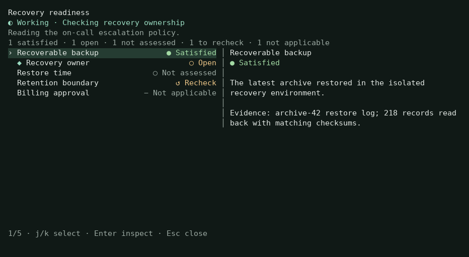
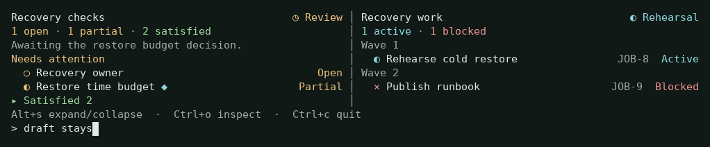

# Pi components

Reusable TypeScript terminal components on `@earendil-works/pi-tui`. This package has no dependency on the Pi coding agent, Studio, Socrates, Beads or a managed worktree. It provides a Vim-first selector, independent condition and activity indicators, and a conditions panel with inspectable evidence.

Install from a repository checkout with a local `file:` dependency on `tools/pi-components`. The package exports TypeScript source; callers need a TypeScript loader or bundler, as the Pi runtime and daily driver already provide. The package is private and is not published to npm. Package installation, scripts and tests use Bun from PATH at or above the minimum in `package.json` (`>=1.4.5`). [Studio](https://github.com/lanej/studio) consumes a vendored snapshot through its own lockfile; refresh that snapshot deliberately when changing this package.

## Selector

`createSelector` returns a Pi TUI `Component` with `render`, `handleInput`, and `invalidate`. The caller supplies a nonempty list, theme functions, a Markdown theme, the available height, a render callback and an `onSelect` callback. An index means an explicit Enter selection; `undefined` means cancellation. Completion fires once. Create a new component for each selection and keep its content stable while it is open.

```ts
import { createSelector } from "@lanej/pi-components";

const selector = createSelector({
  title: "Choose a deployment region",
  items: [
    { label: "West", description: "Primary region", details: "Near the customer." },
    { label: "East", description: "Recovery region" },
  ],
  theme, // accent, muted, bold, selected, and a Pi TUI Markdown theme
  height: () => terminal.rows - 2,
  requestRender: () => tui.requestRender(),
  onSelect: (index) => finish(index),
});
```

Mount the component in a Pi TUI container or return it from a Pi extension's `ctx.ui.custom` factory. The host owns overlay positioning, external cancellation, disposal and any later text input. The selector does not append special choices, persist answers or authorize work. Both prompt and items can carry Markdown explanations and caller-rendered `annotations`; annotation strings are trusted terminal output and may contain OSC 8 links, so sanitize untrusted data before constructing them. `selectorText`, `selectorLink` and `selectorLinks` provide terminal-safe plain text and HTTP(S) link rendering. Domain-specific source links and evidence validation belong to the caller.

Use `j`/`k` to move, `;` to enter visible letter hints, `l` to inspect details, and `h` to return. Completing a hint moves focus without submitting. Enter selects. Escape leaves hints or details before cancelling; Ctrl+C cancels directly. Focus follows resizing and scrolling. Wide layouts show a side preview; narrow layouts place it below the choices.

## Conditions and activity

`conditionStatus` renders one supplied assessment: `○ Open`, `◐ Partial`, `● Satisfied`, `○ Not assessed` (muted), or `− Not applicable`. `Partial` is an explicit categorical judgment. The component never calculates it from evidence length or a fraction. A `stale` assessment displays **Recheck** and remains available as previous evidence. `conditionCounts` returns literal counts with stale observations excluded from current states; `conditionSummary` renders those counts without a percentage or an inferred readiness decision. Empty input explicitly means no conditions were supplied. `conditionMark` returns the same semantic mark for use in another composition.

`activityIndicator` renders `Idle`, `Working`, `Waiting`, or `Paused` separately from those observations. The caller supplies a label, optional detail, and optional `focusId` identifying the current subject. Activity never changes an assessment, selection, or authorization. A supplied animation `frame` animates only `Working`; omitted frames and `reducedMotion: true` preserve a static mark and textual state. `ascii: true` selects an explicit glyph fallback. Components own no clocks.

```ts
import {
  ActivityState, ConditionState, createConditionsPanel,
} from "@lanej/pi-components";

const panel = createConditionsPanel({
  title: "Recovery readiness",
  conditions: [
    {
      id: "backup",
      label: "Recoverable backup",
      state: ConditionState.Satisfied,
      summary: "Archive restored in an isolated environment.",
      details: "Archive 42: 218 records read back with matching checksums.",
    },
    {
      id: "owner", label: "Recovery owner", state: ConditionState.Open,
      summary: "The operator must choose who can initiate a restore.",
    },
  ],
  activity: {
    state: ActivityState.Waiting,
    label: "Choose the recovery owner", focusId: "owner",
  },
  theme, // accent, muted, bold, success, warning, error, selected
  height: () => terminal.rows - 2,
  requestRender: () => tui.requestRender(),
  onClose: () => finish(),
});
```

The panel returns a native Pi `Component`. `setConditions` validates and copies the replacement before applying it, retaining selection by stable ID through reordering. Removing the selected condition selects its nearest surviving position. `setActivity` never moves that selection; the diamond identifies the caller's current subject independently of the selection chevron. `setFrame` lets a host-owned clock request animation frames; stop that clock when the surface closes or work stops.

Wide panels pair the conditions list with evidence for the selected condition. `j`/`k` and arrows move selection, Enter or `l` opens full-width inspection, and `h` returns. Inspection wraps and scrolls complete evidence at narrow widths. Page Up/Down, Home and End work in either view. Escape returns from inspection before closing; Ctrl+C closes directly. The host owns placement, cancellation, data freshness, theme changes and disposal. Condition labels and evidence are treated as plain terminal-safe text, not executable escape sequences or Markdown. New evidence, invalidation and not-applicable reasons remain caller policy.

Run the independent dark-theme recovery example with `bun tools/pi-components/examples/conditions.ts`; add `--still` for reduced motion, `--ascii` for the fallback, or `--render` for a static native rendering. The example owns the animation timer and clears it when closed.



## Parallel status columns



`renderStatusDock` renders one or two `StatusColumn` snapshots as plain terminal lines. Mount it in the host's widget area to keep the editor available. The dock is passive: it has no input handler, modal overlay, timer, or selection. Minimized output uses at most three rows by default; expanded output shows priority rows with an eight-row cap. Pass a smaller `maxRows` for a short terminal. At narrow widths both column phases appear before secondary detail. The caller supplies column titles, phase marks, literal colored counts, ordered groups and evidence. Neither the dock nor inspector infers completion or links across columns.

```ts
const dock = {
  invalidate() {},
  render(width: number) {
    return renderStatusDock({ columns, theme, width, expanded });
  },
};
tui.addChild(dock);
tui.addChild(editor);
tui.setFocus(editor);
```

Use `createStatusBoard` for explicit inspection of the same snapshots. Wide terminals show both columns, each with its own groups and remembered selection. Narrow terminals keep both phase headings and show the selected column's rows. `Tab`/`Shift+Tab`, `h`/`l`, or arrows switch columns; `j`/`k` select a row; Enter inspects the full evidence. Specify `initialColumnId` to open the relevant side directly. Escape returns from evidence, then closes the inspector. `?` shows the key guide. Its height is a maximum; short content leaves space available to the host.

Give foldable groups stable IDs and set `collapsed: true` to start folded or `false` to start open. Enter on the group heading toggles it. Groups without a `collapsed` value remain expanded. Set `showStatusLabels: false` when the group name already gives every row's state; rows retain their colored glyphs. The optional column `focusId` marks current work independently of the operator's selection. `setColumns` validates and copies replacements, retaining local folds and selections by ID. The host owns all effects and keyboard shortcuts used to open or toggle these surfaces.

Run `bun tools/pi-components/examples/status-board.ts` for a native, interactive two-column recovery rehearsal. Type in the editor, press Alt+s to expand or minimize the dock, and Ctrl+o to inspect the checks and implementation work. `--render` prints a static dock; add `--expanded`, `--inspect`, or `--narrow` to inspect dimensions without a TTY.

## Checks

```sh
bun install --cwd tools/pi-components --frozen-lockfile --ignore-scripts
bun run --cwd tools/pi-components quality:tools
make test-pi-components
```

The independent strict profile covers compiler, typed lint, formatting, interaction tests and dependency audit. Studio's independent workflow checks its vendored consumer. Native Socrates acceptance verifies the installed package through its real caller; it is described in [Studio's acceptance guide](https://github.com/lanej/studio/blob/main/acceptance/local-run.md).
