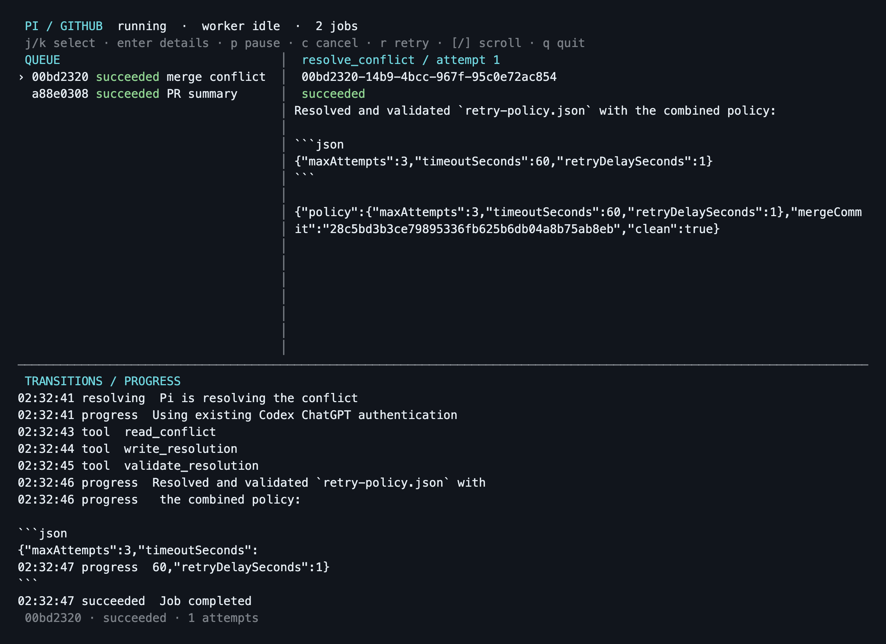
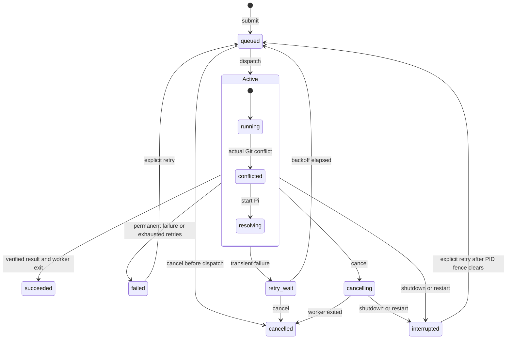

# Pi GitHub scheduler

A working-path experiment in scheduling Pi workers: a persistent FIFO queue, explicit job states, a terminal dashboard, a real disposable Git conflict, and a public GitHub PR summary. The coordinator owns state and tools; Pi performs the bounded reasoning task.

## Run

Requires Bun 1.4.4 or newer, Git, and GitHub CLI. The project pins Pi 1.5.0 and uses its coding-agent SDK and terminal UI.

From the dotfiles root:

```sh
cd tools/pi-github
bun install --frozen-lockfile --ignore-scripts
bun run build
```

The worker uses existing Pi ChatGPT authentication when configured, otherwise references your existing file-backed Codex ChatGPT session under `CODEX_HOME` (default `~/.codex`). No additional sign-in is needed when that session has a sufficiently fresh access token. The reference is read-only and held in memory: it does not create a Pi credential file, pass through refresh or identity tokens, or change Codex authentication. Codex retains responsibility for refreshing its own session; expired or nearly expired sessions fail with a refresh diagnosis. This fallback currently supports file-backed ChatGPT sessions, not OS-keychain-only or API-key Codex sessions.

If neither application has a usable session, `bin/pi-github login` opens Pi with tools and discovery disabled. Enter `/login openai-codex`, complete sign-in, and then `/quit`. Pi stores its own resulting authentication in its private agent directory; `PI_CODING_AGENT_DIR` can select a different directory. The default model is `gpt-6.1-terra`; pass `--model MODEL` when starting the coordinator to select another OpenAI Codex provider model.

Run the remaining commands from `tools/pi-github`. Dependencies and builds remain local to the tool; runtime state lives in the selected state directory. This addition does not change dotfiles installation or MCP configuration.

Start the dashboard in one terminal:

```sh
bin/pi-github dashboard
```

In another terminal, or from Codex:

```sh
bin/pi-github demo --request-id first-demo --json
bin/pi-github get JOB_ID --json
bin/pi-github events JOB_ID --watch
```

Both processes must use the same state directory. The default is `~/.local/state/pi-github`; override it with `--state DIR` or `PI_GITHUB_STATE`. `serve` runs the same foreground coordinator without a dashboard for automation. It does not install a daemon or modify Codex MCP configuration.

GitHub reads use the existing `gh` login. If authentication fails, use the supported `gh auth login -h github.com` flow. Private or indeterminate repository visibility is rejected before PR content enters model context. Public PR text still goes to the selected OpenAI model provider.



The screenshot shows a live Bun run using existing Codex and GitHub authentication. See the [acceptance record](docs/live-acceptance.md) for the observed merge and job results.

## Dashboard and commands

The dashboard shows the queue, the selected job, and its transitions and progress. Use arrows or `j/k` to select, `Enter` to expand details, `p` to pause/resume dispatch, `c` to cancel, `r` to retry failed/interrupted work, `[` and `]` to scroll, and `q` to shut down gracefully. Narrow terminals stack the panes.

```text
pi-github submit summarize-pr --url https://github.com/OWNER/REPO/pull/NUMBER --request-id ID
pi-github get JOB_ID --json
pi-github events JOB_ID --after SEQUENCE [--watch]
pi-github cancel JOB_ID
pi-github retry JOB_ID
pi-github pause
pi-github resume
```

Submissions return a durable job handle. Repeating a request ID and task returns the existing job; changing the task under that ID fails. CLI results are JSON; `--json` selects compact output. Events are JSONL, with at most 200 records per page. With `--watch`, the client follows subsequent pages until terminal state; otherwise use the last sequence as the next cursor.

The project-local Codex skill under `.agents/skills/pi-github` describes delegation and result retrieval. It applies when Codex works in `tools/pi-github`, without installing a user-wide integration.

## Scheduling and state

One coordinator and one worker run per state directory. SQLite commits state and transition events before dispatch. A separate SQLite exclusive lock protects coordinator ownership before stale-socket cleanup. The socket and state directory are owner-only; this isolates other local accounts, not other unrestricted processes under the same account.



`Active` groups `running`, `conflicted`, and `resolving`; each can take the shared outgoing transitions. A job may already be terminal while fixture cleanup finishes; the worker slot remains busy until that cleanup completes. Scheduler pause/resume and worker recovery are separate from job state. During recovery, dispatch remains fenced until every unresolved previous worker PID has exited.

Pause leaves active work running. Retryable provider or transport failures receive at most three attempts, delayed by one and five seconds. Authentication and invalid resolutions do not retry automatically. Manual retry resets that automatic retry budget while retaining the attempt history. Each conflict attempt gets a fresh fixture.

Workers cannot start model or tool work before the coordinator persists their PID. Attempt IDs fence stale messages; cancellation takes precedence over late completion. A cancelled worker keeps the slot until it exits. On shutdown the coordinator aborts active work, escalates to process termination after five seconds, and preserves queued work. Restart marks unfinished work interrupted and waits for every unresolved previous worker PID to disappear before dispatch. A reused PID conservatively blocks recovery rather than risking termination of another process.

The worker has a three-minute attempt deadline, twelve model turns, forty tool calls, and bounded displayed output. The coordinator permits only the tools appropriate to the current job. No shell or project tools are exposed, and project instructions, skills, extensions, and prompt discovery are disabled in worker sessions. Pi is not an operating-system sandbox; installed dependencies and the host process remain trusted.

## Deliberate conflict

`demo` queues a conflict-resolution job and then a summary of public Pi PR 11546. The first job generates a disposable repository, creates two branches, and performs an actual conflicting merge on `retry-policy.json`.

| Version | maxAttempts | timeoutSeconds | retryDelaySeconds |
| --- | ---: | ---: | ---: |
| Base | 1 | 30 | 1 |
| Target | 3 | 30 | 1 |
| Source | 5 | 60 | 1 |
| Required resolution | 3 | 60 | 1 |

Pi reads the conflict and receives the explicit resolution requirements. Its write tool accepts a policy object and touches only the generated policy file. An independent checker rejects either unchanged side, conflict markers, invalid values, extra keys, and unrelated changed paths. Only the coordinator stages and commits the resolution. It confirms a clean merge with two parents, stores the result, and removes the fixture. Generated repositories ignore user Git hooks and signing configuration. No user's repository or remote GitHub object is changed.

The scheduler and conflict states are the focus of this thread. PR summaries deliberately omit CI analysis, and this implementation has no recurring schedules, concurrent worker pool, MCP server, or remote mutation operations.

## Verify

```sh
bun run check
```

The check builds the TypeScript source and exercises real fixture merges, controlled worker processes, local socket clients, durable scheduling, cancellation, retry timing, recovery, and terminal rendering. The controlled worker is a test fixture, not a substitute for live Pi acceptance. Tests require permission to create Unix sockets and inspect their own child processes.

Live acceptance requires existing ChatGPT authentication and GitHub access. Run the dashboard and demo, inspect the conflict transitions and merged policy, and confirm the waiting PR job subsequently finishes. Tests use synthetic authentication fixtures and never use provider credentials or send private repository content.
