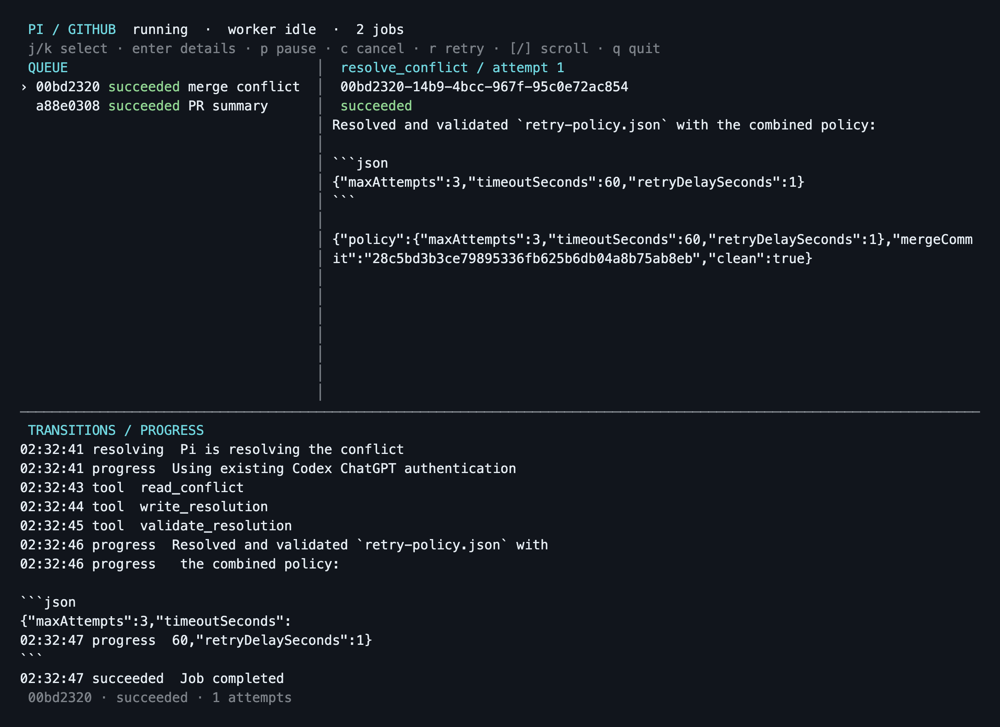

# Live steel-thread acceptance

On 2026-11-08, the native Pi dashboard ran the two-job `demo` under Bun 1.4.4 from `tools/pi-github`, using the existing file-backed Codex ChatGPT session and existing GitHub CLI authentication. No additional sign-in or credential file was created.



The screenshot is the actual dashboard output captured from a 120-column, 36-row PTY during this run, replayed in xterm.js and photographed by headless Chromium. Its queue, job details, and events come from the live coordinator; no sample snapshot was substituted. The capture process continuously drained the PTY so terminal backpressure could not stall the coordinator.

The conflict job `00bd2320-14b9-4bcc-967f-95c0e72ac854` passed through `queued`, `running`, `conflicted`, `resolving`, and `succeeded`. Its event stream contained actual Git conflict markers, then the live model called `read_conflict`, `write_resolution`, and `validate_resolution`. The coordinator independently checked the required policy, clean worktree, and two-parent merge before reporting success.

```json
{"policy":{"maxAttempts":3,"timeoutSeconds":60,"retryDelaySeconds":1},"mergeCommit":"28c5bd3b3ce79895336fb625b6db04a8b75ab8eb","clean":true}
```

The conflict worker's exit was observed before job `a88e0308-eb72-4a39-802e-18a59eaefe9f` started. That second job read public [Pi PR 11546](https://github.com/earendil-works/pi/pull/11546) through the coordinator and successfully returned a summary of its output-buffer cap and related changes. Both jobs succeeded on their first attempt, and their worker exits were recorded. Remote GitHub writes were not exercised; this worker supports reads only.

`bun run check` passed all 24 tests, including synthetic auth-reference tests and scheduler/process regressions. Independent static review found no runtime or security blockers in the Bun migration. The disposable repository and temporary scheduler state were removed after inspection; the recorded merge hash identifies that local acceptance run and is not a published commit.

To repeat, enter `tools/pi-github`, run `bun install --frozen-lockfile --ignore-scripts` and `bun run build`, start `bin/pi-github dashboard`, and run `bin/pi-github demo --request-id YOUR_UNIQUE_ID --json` from another terminal using the same state directory. Inspect both job handles with `get` and `events`. A usable existing session and network access are required; this result establishes the observed run, not future provider availability.
